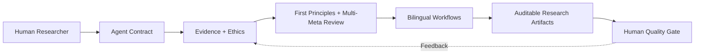

# Research-to-Publication AI v2.0

**An evidence-driven, bilingual scholarly research and publication operating skill.**

**Creator and maintainer:** Tri Aji Nugroho  
**Languages:** Indonesian & English  
**Status:** proprietary; see [LICENSE](LICENSE).  
**Version:** 2.0.0 | **Released:** 14 October 2026.

> **North Star:** Publishable work emerges from good research, not from fluent text. Evidence, integrity, and genuine contribution precede editorial polish.

## What this does

The skill integrates research design, source-traceable gap identification, defensible novelty, argument mapping, quantitative/qualitative/review methods, manuscript drafting, adversarial peer-review simulation, journal-fit checks, and submission readiness. It supports researchers, educators, interdisciplinary teams and institutional research groups; it does not replace domain expertise.

## Quick start

1. Read `SKILL.md` and `references/quality-framework.md`.
2. Provide authorized, privacy-safe materials: research protocols, variables, anonymized datasets, codebooks, verified literature, and target-venue instructions.
3. Use: `Activate research-to-publication in /triage mode. Reply in English. Inventory evidence, identify integrity risks, produce a decision memo, claim ledger, and three next actions. Never invent sources or results.`
4. Iterate stage-by-stage using `playbooks/en/workflow.md` and `prompts/en/prompt-pack.md`. Resolve hard stops before proceeding.

## Architecture

| Module | Location | Purpose |
|---|---|---|
| Agent instructions | [SKILL.md](SKILL.md) | Activation and non-negotiable controls |
| Five-lens model, fallacy detox | [quality framework](references/quality-framework.md) | Reasoning and decision quality |
| English workflow | [playbook](playbooks/en/workflow.md) | Execution through submission |
| Indonesian workflow | [playbook](playbooks/id/workflow.md) | Local academic practice |
| English and Indonesian prompts | [prompts/en](prompts/en/prompt-pack.md) · [prompts/id](prompts/id/prompt-pack.md) | Operational reusable instructions |
| Verified resource directory | [resources](references/resources.md) | Institutional/national/global sources |
| Research templates | [templates](templates/) | Evidence, decisions and reviewer responses |
| Hypothetical demonstration | [synthetic example](examples/synthetic-case.md) | Learning without fabricated real-world claims |
| Portable single file | [full package](dist/Research_to_Publication_AI_Skill_v2_Bilingual_All_in_One.md) | Offline/cross-platform usage |

## Intellectual property, integrity, and practical limitations

Copyright © 2026 Tri Aji Nugroho. All rights reserved, to the extent protectable under applicable law. The repository is currently public: visibility does not grant a reuse license or confidentiality. External standards and linked resources retain their owners' rights. Record substantial human creative choices, revisions, and source verification; AI-generated drafts may have jurisdiction-specific protectability limits. This is not legal advice. Author responsibility for submitted manuscripts remains with accountable humans. See [LICENSE](LICENSE) and [AUTHORSHIP.md](AUTHORSHIP.md).

[Ringkasan Indonesia](README.md)

