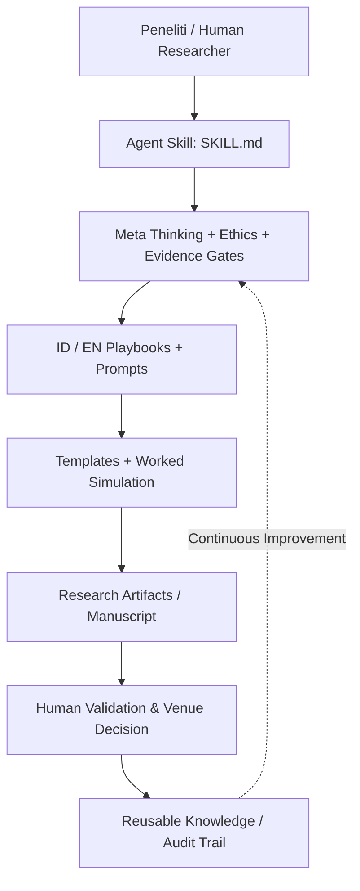

# Research-to-Publication AI v2.0

**Sistem penelitian-ke-publikasi berbasis bukti, refleksi multi-meta, dan kualitas akademik.**

**Kreator dan pengelola:** Tri Aji Nugroho  
**Bahasa:** Indonesia & English  
**Status:** proprietary; hak cipta dan kebijakan penggunaan pada [LICENSE](LICENSE).  
**Versi:** 2.0.0 | **Tanggal:** 14 Oktober 2026.

> **North Star:** Publikasi adalah konsekuensi dari penelitian bermutu, bukan substitusi untuk penelitian. Research quality first; publication is an outcome, not a shortcut.

## Fungsi utama

Mengintegrasikan: desain riset, research gap/novelty yang dapat dibuktikan, logika argumen, integritas bukti, analisis kuantitatif/kualitatif/SLR, scientific writing, quality gates, simulasi reviewer, pemilihan venue, dan berkas submission. Cocok untuk mahasiswa, dosen, peneliti, organisasi riset dan tim multidisiplin—tetap memerlukan penilaian ahli sesuai bidang.

## Quick start

1. Baca `SKILL.md` serta `references/quality-framework.md`.
2. Unggah/lampirkan bahan yang sah, terotorisasi dan aman: protokol, variabel, data teranonimkan, codebook, literatur terverifikasi, guideline venue.
3. Instruksikan: `Aktifkan research-to-publication. Mode /triage. Bahasa Indonesia. Lakukan inventaris bukti; jangan mengarang temuan; buat decision memo, evidence ledger dan 3 prioritas.`
4. Kerjakan per fase; jangan melewati quality gate yang gagal. Gunakan `prompts/id/prompt-pack.md`.

## Sistem berlapis

**Pemisahan konseptual:** bukti bukan interpretasi; fakta bukan asumsi; gap riset bukan klaim novelty; nilai p bukan besar manfaat; reviewer simulation bukan reviewer riil; siap disubmit bukan dijamin diterima.

## Modul

| Komponen | Lokasi | Tujuan |
|---|---|---|
| Agent contract | [SKILL.md](SKILL.md) | Aturan eksekusi lintas model |
| Model mutu | [quality-framework.md](references/quality-framework.md) | MECE, multi-meta, risk/reality checks |
| Playbook Indonesia | [workflow.md](playbooks/id/workflow.md) | 18 tahap operasional |
| English workflow | [workflow.md](playbooks/en/workflow.md) | International transfer |
| Prompt Indonesia | [prompt-pack.md](prompts/id/prompt-pack.md) | Prompt operasional |
| English prompts | [prompt-pack.md](prompts/en/prompt-pack.md) | Equivalent task modules |
| Resources | [resources.md](references/resources.md) | Nasional & internasional + institutional overlay |
| Templates | [templates/](templates/) | Tabel dan gerbang audit |
| Simulasi | [synthetic-case.md](examples/synthetic-case.md) | End-to-end didaktik tanpa data riil |
| Versi satu berkas | [dist](dist/Research_to_Publication_AI_Skill_v2_Bilingual_All_in_One.md) | Distribusi portabel |
| Ketentuan hak | [LICENSE](LICENSE), [AUTHORSHIP.md](AUTHORSHIP.md) | Governance IP |

## Batasan

- Tidak menggantikan PI, pembimbing, reviewer, editor, konsultan statistik, komite etik, atau penasihat hukum.
- Tidak mengakses perangkat/berkas/situs kecuali alat tersedia dan diotorisasi; ungkapkan keterbatasan.
- Versi repository ini **publik**, sehingga materi yang diunggah dapat dibaca orang; All Rights Reserved bukan mekanisme kerahasiaan.
- Rujukan eksternal adalah sumber normatif/ilmiah, bukan izin mengambil materi pihak lain ke dalam produk.

## Kepemilikan & pemeliharaan

Copyright © 2026 Tri Aji Nugroho. All rights reserved, sepanjang hak-hak yang memang dapat dilindungi menurut hukum. Kontribusi manusia dan revisi editorial perlu dicatat; fakta, ide/metode abstrak, serta materi pihak ketiga tidak otomatis menjadi milik kreator. Untuk penggunaan ulang, distribusi, pengubahan, atau komersialisasi, ikuti `LICENSE`. Perubahan dicatat di `CHANGELOG.md`; publikasi dan kepengarangan penelitian mengikuti kebijakan venue.

[English overview](README.en.md) · [Author governance](AUTHORSHIP.md)

