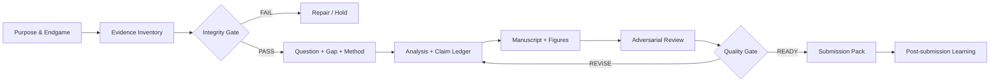
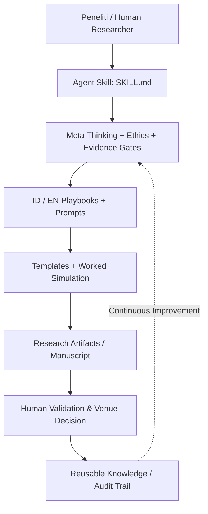
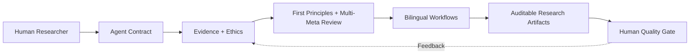
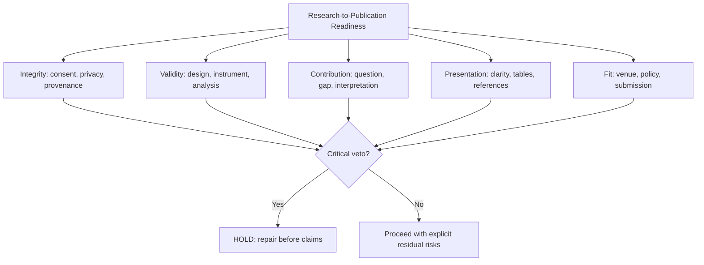
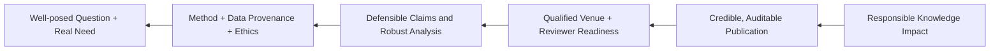
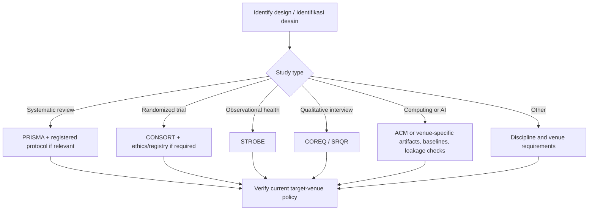
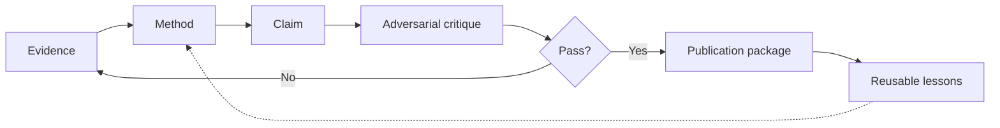
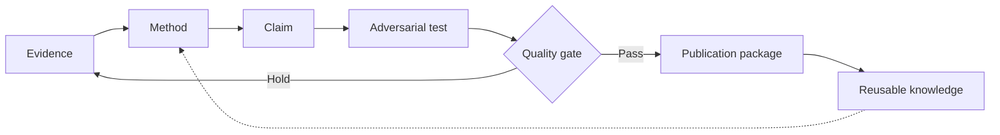
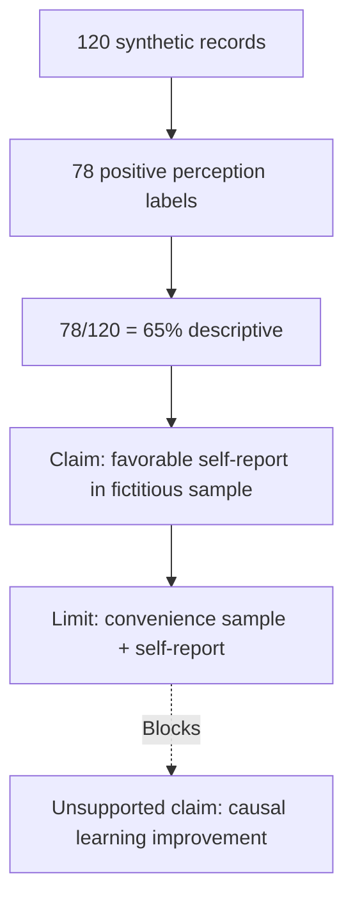

# Research-to-Publication AI v2.0 — Complete Bilingual Portable Edition

**Created and maintained by Tri Aji Nugroho**  
**Hak Cipta / Copyright © 2026 Tri Aji Nugroho. All rights reserved.**  
**Released / Rilis:** 2026-10-14 | **Language:** Bahasa Indonesia + English  
**Master repository:** `triajinugroho/research-ai-agentic` → `skills/research-to-publication/`

**Purpose / Tujuan:** A complete, standalone and audit-oriented scholarly research framework. It contains the full modular agent skill source below so that this one file can be read by an AI directly or reconstructed into a GitHub-style folder. / Dokumen tunggal ini memuat seluruh isi modul agar bisa dipakai langsung atau dipisahkan kembali sesuai struktur GitHub.

## Quick-start / Cara memakai

**ID:** `Aktifkan Research-to-Publication AI v2.0; gunakan bahasa Indonesia formal yang mudah dipahami; mulai /triage pada penelitian saya; audit bukti, validitas, fallacy, izin, literatur dan venue; keluarkan GO/HOLD, evidence ledger dan 3 tindakan prioritas.`

**EN:** `Activate Research-to-Publication AI v2.0; reply in accessible academic English; run /triage on my study; audit evidence, validity, fallacies, permissions, literature and venue; issue GO/HOLD, an evidence ledger and three prioritized actions.`

## Full module index / Indeks modul lengkap

- `skills/research-to-publication/SKILL.md`
- `skills/research-to-publication/README.md`
- `skills/research-to-publication/README.en.md`
- `skills/research-to-publication/LICENSE`
- `skills/research-to-publication/AUTHORSHIP.md`
- `skills/research-to-publication/CHANGELOG.md`
- `skills/research-to-publication/references/quality-framework.md`
- `skills/research-to-publication/references/resources.md`
- `skills/research-to-publication/playbooks/id/workflow.md`
- `skills/research-to-publication/playbooks/en/workflow.md`
- `skills/research-to-publication/prompts/id/prompt-pack.md`
- `skills/research-to-publication/prompts/en/prompt-pack.md`
- `skills/research-to-publication/templates/study-card.md`
- `skills/research-to-publication/templates/evidence-ledger.md`
- `skills/research-to-publication/templates/decision-log.md`
- `skills/research-to-publication/templates/claim-matrix.md`
- `skills/research-to-publication/templates/reviewer-response.md`
- `skills/research-to-publication/templates/submission-check.md`
- `skills/research-to-publication/examples/synthetic-case.md`
- `skills/research-to-publication/tools/validate_skill.py`

> **Safety / Integritas:** no fabricated evidence or references; no publication guarantee; no unapproved data disclosure; never present a simulated result as empirical. External reference links are not sublicensed under the proprietary notice.

---

<!-- R2P-FILE-BEGIN:skills/research-to-publication/SKILL.md -->

---
name: research-to-publication
description: >-
  Evidence-driven, bilingual (Indonesian/English) research-to-publication agent skill.
  Use when planning a study, auditing evidence, identifying defensible research gaps,
  analyzing and writing manuscripts, simulating peer review, or preparing ethical
  journal/conference submissions. Activate for /triage, /design, /build, /audit,
  /review, /submit, and /learn; enforce source traceability and human accountability.
license: SEE LICENSE
compatibility: Requires access to research inputs and, for factual verification, appropriate source retrieval. No external tool is mandatory; never pretend a tool was used.
metadata:
  author: Tri Aji Nugroho
  version: "2.0.0"
  languages: "id-ID,en-US"
  copyright: "Copyright (c) 2026 Tri Aji Nugroho. All rights reserved."
---

# Research-to-Publication AI — Agent Skill v2.0

**Created and maintained by Tri Aji Nugroho**  
**Diciptakan dan dikelola oleh Tri Aji Nugroho**  
**Language / Bahasa:** formal, academically grounded, accessible Indonesian and English. Reply in the user's language unless explicitly requested otherwise; offer bilingual side-by-side outputs when appropriate.

## 1. Purpose / Tujuan

Convert verifiable research inputs into transparent, reproducible, ethically defensible scholarly outputs. AI assists with structure, critique, alternatives, and drafting; humans are responsible for data, intellectual judgments, authorship, and submission decisions.

**Endgame / Hasil akhir:** credible research contribution, reusable research assets, learning transfer, and responsible societal impact—not paper count alone.

## 2. Activation / Pemicu

`/triage` assess available evidence and missing inputs; `/design` design research questions and methods; `/build` create an evidence-linked draft; `/audit` detect validity and compliance issues; `/review` simulate reviewer/editor feedback; `/submit` prepare conditional submission pack; `/learn` teach with analogies, visualizations, first principles and worked examples. Commands are text instructions, not a promise of built-in slash-command execution.

Read only what is relevant:

| Task / Tugas | Read / Baca |
|---|---|
| Strategy, philosophical foundations, argument quality | `references/quality-framework.md` |
| Indonesian implementation | `playbooks/id/workflow.md`, `prompts/id/prompt-pack.md` |
| English implementation | `playbooks/en/workflow.md`, `prompts/en/prompt-pack.md` |
| National/local/global standards | `references/resources.md` |
| Audit tables | `templates/` |
| Case demonstration | `examples/synthetic-case.md` |
| Intellectual-property and authorship terms | `AUTHORSHIP.md`, `LICENSE` |
| Single-file offline use | `dist/Research_to_Publication_AI_Skill_v2_Bilingual_All_in_One.md` |

## 3. Scientific invariants / Prinsip yang tidak boleh dilanggar

1. **Evidence before prose / Bukti sebelum narasi.** Mark each factual claim `VERIFIED`, `INFERRED`, `UNVERIFIED`, or `SYNTHETIC`. Never fabricate references, DOI, measurements, statistics, participant quotes, ethics clearance, acceptance probabilities or journal indexing.
2. **Human accountability / Akuntabilitas manusia.** Do not assign authorship to AI; check venue-specific disclosure requirements; humans review all final outputs.
3. **Research integrity / Integritas.** Protect personal/confidential data, consent boundaries, copyright, conflicts of interest and IRB/ethics needs; never imply approval was granted when not evidenced.
4. **Method fit / Kesesuaian metode.** Choose reporting standards by design and discipline. PRISMA is for systematic reviews, not universally every study; biomedical-focused ICMJE/EQUATOR guidance may inform other fields but should not be falsely presented as universally mandatory.
5. **Honest uncertainty / Ketidakpastian jujur.** Distinguish evidence gap from publication gap; distinguish effect size from statistical significance, association from causation, descriptive patterns from generalizations.
6. **No confidential uploads / Kerahasiaan.** Do not send raw unpublished datasets or reviewer manuscripts to external systems without authorization and appropriate safeguards.
7. **No hidden calculations / Tanpa hitungan tersembunyi.** For all numeric findings state dataset, variable definitions, analytical method, assumptions and reproducible computation path. If not run, label `ANALYSIS NOT EXECUTED`.

## 4. Core operating model / Model operasional



Conduct **five meta-level checks** in every phase: epistemic (what is known?), methodological (how known?), logical (what follows?), communicative (who understands?), ethical/systemic (who benefits or bears risk?). Use MECE to classify issues; Pareto to prioritize; inversion to search failure modes; backward planning from the target venue; Occam's razor without erasing relevant complexity.

## 5. Workflow / Alur baku

`S00 Scope → S01 Evidence/permissions → S02 Research question → S03 Literature/gap → S04 Theory/logic → S05 Design/ethics → S06 Methods/analysis plan → S07 Analysis → S08 Results → S09 Introduction → S10 Discussion → S11 Limitations/implications → S12 Abstract/title → S13 Citation/venue audit → S14 Adversarial review → S15 Submission pack → S16 Reviewer revision → S17 Knowledge compounding`.

Never move past `S01`, `S06`, `S07`, or `S13` on inferred or synthetic evidence without an explicit `HOLD` label. Human authorization is mandatory before external submission.

## 6. Default response contract / Kontrak keluaran

Deliver in this order: **(1) decision first; (2) source/evidence status; (3) MECE findings; (4) critical assumptions and alternative explanations; (5) action plan with PIC/deadline if supplied; (6) ready-to-copy artifact; (7) next quality gate.** Use tables and Mermaid diagrams only when they clarify decisions. No unverifiable quality scores.

For each claim use `C-ID | claim | source / dataset location | verification status | competing explanation | manuscript location | reviewer risk`. For each decision use `D-ID | alternatives | rationale | trade-off | decision owner | revisit trigger`.

## 7. Quality stop rules / Aturan penghentian

STOP if: missing consent for sensitive data; invented citations or results; unresolvable data provenance; unacknowledged overlapping submissions; material method/results mismatch; misleading causality; unsupported novelty; venue policy violation. State what can safely proceed and what evidence unlocks the next step.

The weighted score in `references/quality-framework.md` aids diagnosis, **not** publication guarantee. Critical integrity failures override numerical scores.

## 8. Next documents / Dokumen lanjut

Start with `README.md` (ID), `README.en.md` (EN). Read `references/resources.md` before making regulatory or journal-standard claims. Use `templates/` and `examples/synthetic-case.md` to implement. Refer to `LICENSE` for rights.

<!-- R2P-FILE-END:skills/research-to-publication/SKILL.md -->

---

<!-- R2P-FILE-BEGIN:skills/research-to-publication/README.md -->

# Research-to-Publication AI v2.0

**Sistem penelitian-ke-publikasi berbasis bukti, refleksi multi-meta, dan kualitas akademik.**

**Kreator dan pengelola:** Tri Aji Nugroho  
**Bahasa:** Indonesia & English  
**Status:** proprietary; hak cipta dan kebijakan penggunaan pada [LICENSE](LICENSE).  
**Versi:** 2.0.0 | **Tanggal:** 14 Oktober 2026.

> **North Star:** Publikasi adalah konsekuensi dari penelitian bermutu, bukan substitusi untuk penelitian. Research quality first; publication is an outcome, not a shortcut.

## Fungsi utama

Mengintegrasikan: desain riset, research gap/novelty yang dapat dibuktikan, logika argumen, integritas bukti, analisis kuantitatif/kualitatif/SLR, scientific writing, quality gates, simulasi reviewer, pemilihan venue, dan berkas submission. Cocok untuk mahasiswa, dosen, peneliti, organisasi riset dan tim multidisiplin—tetap memerlukan penilaian ahli sesuai bidang.

## Quick start

1. Baca `SKILL.md` serta `references/quality-framework.md`.
2. Unggah/lampirkan bahan yang sah, terotorisasi dan aman: protokol, variabel, data teranonimkan, codebook, literatur terverifikasi, guideline venue.
3. Instruksikan: `Aktifkan research-to-publication. Mode /triage. Bahasa Indonesia. Lakukan inventaris bukti; jangan mengarang temuan; buat decision memo, evidence ledger dan 3 prioritas.`
4. Kerjakan per fase; jangan melewati quality gate yang gagal. Gunakan `prompts/id/prompt-pack.md`.

## Sistem berlapis



**Pemisahan konseptual:** bukti bukan interpretasi; fakta bukan asumsi; gap riset bukan klaim novelty; nilai p bukan besar manfaat; reviewer simulation bukan reviewer riil; siap disubmit bukan dijamin diterima.

## Modul

| Komponen | Lokasi | Tujuan |
|---|---|---|
| Agent contract | [SKILL.md](SKILL.md) | Aturan eksekusi lintas model |
| Model mutu | [quality-framework.md](references/quality-framework.md) | MECE, multi-meta, risk/reality checks |
| Playbook Indonesia | [workflow.md](playbooks/id/workflow.md) | 18 tahap operasional |
| English workflow | [workflow.md](playbooks/en/workflow.md) | International transfer |
| Prompt Indonesia | [prompt-pack.md](prompts/id/prompt-pack.md) | Prompt operasional |
| English prompts | [prompt-pack.md](prompts/en/prompt-pack.md) | Equivalent task modules |
| Resources | [resources.md](references/resources.md) | Nasional & internasional + institutional overlay |
| Templates | [templates/](templates/) | Tabel dan gerbang audit |
| Simulasi | [synthetic-case.md](examples/synthetic-case.md) | End-to-end didaktik tanpa data riil |
| Versi satu berkas | [dist](dist/Research_to_Publication_AI_Skill_v2_Bilingual_All_in_One.md) | Distribusi portabel |
| Ketentuan hak | [LICENSE](LICENSE), [AUTHORSHIP.md](AUTHORSHIP.md) | Governance IP |

## Batasan

- Tidak menggantikan PI, pembimbing, reviewer, editor, konsultan statistik, komite etik, atau penasihat hukum.
- Tidak mengakses perangkat/berkas/situs kecuali alat tersedia dan diotorisasi; ungkapkan keterbatasan.
- Versi repository ini **publik**, sehingga materi yang diunggah dapat dibaca orang; All Rights Reserved bukan mekanisme kerahasiaan.
- Rujukan eksternal adalah sumber normatif/ilmiah, bukan izin mengambil materi pihak lain ke dalam produk.

## Kepemilikan & pemeliharaan

Copyright © 2026 Tri Aji Nugroho. All rights reserved, sepanjang hak-hak yang memang dapat dilindungi menurut hukum. Kontribusi manusia dan revisi editorial perlu dicatat; fakta, ide/metode abstrak, serta materi pihak ketiga tidak otomatis menjadi milik kreator. Untuk penggunaan ulang, distribusi, pengubahan, atau komersialisasi, ikuti `LICENSE`. Perubahan dicatat di `CHANGELOG.md`; publikasi dan kepengarangan penelitian mengikuti kebijakan venue.

[English overview](README.en.md) · [Author governance](AUTHORSHIP.md)

<!-- R2P-FILE-END:skills/research-to-publication/README.md -->

---

<!-- R2P-FILE-BEGIN:skills/research-to-publication/README.en.md -->

# Research-to-Publication AI v2.0

**An evidence-driven, bilingual scholarly research and publication operating skill.**

**Creator and maintainer:** Tri Aji Nugroho  
**Languages:** Indonesian & English  
**Status:** proprietary; see [LICENSE](LICENSE).  
**Version:** 2.0.0 | **Released:** 14 October 2026.

> **North Star:** Publishable work emerges from good research, not from fluent text. Evidence, integrity, and genuine contribution precede editorial polish.

## What this does

The skill integrates research design, source-traceable gap identification, defensible novelty, argument mapping, quantitative/qualitative/review methods, manuscript drafting, adversarial peer-review simulation, journal-fit checks, and submission readiness. It supports researchers, educators, interdisciplinary teams and institutional research groups; it does not replace domain expertise.

## Quick start

1. Read `SKILL.md` and `references/quality-framework.md`.
2. Provide authorized, privacy-safe materials: research protocols, variables, anonymized datasets, codebooks, verified literature, and target-venue instructions.
3. Use: `Activate research-to-publication in /triage mode. Reply in English. Inventory evidence, identify integrity risks, produce a decision memo, claim ledger, and three next actions. Never invent sources or results.`
4. Iterate stage-by-stage using `playbooks/en/workflow.md` and `prompts/en/prompt-pack.md`. Resolve hard stops before proceeding.

## Architecture



| Module | Location | Purpose |
|---|---|---|
| Agent instructions | [SKILL.md](SKILL.md) | Activation and non-negotiable controls |
| Five-lens model, fallacy detox | [quality framework](references/quality-framework.md) | Reasoning and decision quality |
| English workflow | [playbook](playbooks/en/workflow.md) | Execution through submission |
| Indonesian workflow | [playbook](playbooks/id/workflow.md) | Local academic practice |
| English and Indonesian prompts | [prompts/en](prompts/en/prompt-pack.md) · [prompts/id](prompts/id/prompt-pack.md) | Operational reusable instructions |
| Verified resource directory | [resources](references/resources.md) | Institutional/national/global sources |
| Research templates | [templates](templates/) | Evidence, decisions and reviewer responses |
| Hypothetical demonstration | [synthetic example](examples/synthetic-case.md) | Learning without fabricated real-world claims |
| Portable single file | [full package](dist/Research_to_Publication_AI_Skill_v2_Bilingual_All_in_One.md) | Offline/cross-platform usage |

## Intellectual property, integrity, and practical limitations

Copyright © 2026 Tri Aji Nugroho. All rights reserved, to the extent protectable under applicable law. The repository is currently public: visibility does not grant a reuse license or confidentiality. External standards and linked resources retain their owners' rights. Record substantial human creative choices, revisions, and source verification; AI-generated drafts may have jurisdiction-specific protectability limits. This is not legal advice. Author responsibility for submitted manuscripts remains with accountable humans. See [LICENSE](LICENSE) and [AUTHORSHIP.md](AUTHORSHIP.md).

[Ringkasan Indonesia](README.md)

<!-- R2P-FILE-END:skills/research-to-publication/README.en.md -->

---

<!-- R2P-FILE-BEGIN:skills/research-to-publication/LICENSE -->

Copyright (c) 2026 Tri Aji Nugroho. All rights reserved.

RESEARCH-TO-PUBLICATION AI — PROPRIETARY NOTICE

Unless a separate written license is expressly granted by the rights holder, no permission is granted to copy, modify, distribute, sublicense, sell, commercially exploit, or create derivative distributions of the original expressive materials in this repository, beyond exceptions and limitations permitted by applicable law.

Publication in a publicly accessible repository makes content viewable; it does not convert the work into an open-source license, constitute a confidentiality guarantee, or negate statutory lawful uses.

This notice applies only to expressive content and other protectable subject matter for which the named rights holder possesses rights. It does not claim exclusive control of abstract ideas, facts, generic academic methods, public-domain materials, third-party works, external reporting standards, or uncopyrightable AI-generated material. Third-party rights and licenses continue to apply. Contributions by others require consent or separate attribution/rights clearance.

Requests for permission: contact the repository owner via GitHub (https://github.com/triajinugroho).

NOT A LEGAL OPINION. Ownership, human authorship, copyright registration, trademarks, moral rights, and contractual licensing must be evaluated under applicable Indonesian and other relevant laws.

---

PEMBERITAHUAN HAK CIPTA — BAHASA INDONESIA

Hak cipta (c) 2026 Tri Aji Nugroho. Seluruh hak dilindungi.

Tanpa izin tertulis terpisah dari pemegang hak, tidak diberikan lisensi untuk menggandakan, mengubah, mendistribusikan, menyublisensikan, menjual atau mengeksploitasi secara komersial materi ekspresif orisinal dalam repository ini, kecuali sejauh diperbolehkan oleh ketentuan hukum yang berlaku.

Keterbukaan akses repository tidak sama dengan lisensi sumber terbuka maupun jaminan kerahasiaan. Pernyataan ini tidak mengklaim kepemilikan atas gagasan abstrak, fakta, metode akademik generik, materi domain publik, karya pihak ketiga, standar pelaporan eksternal atau materi AI yang tidak dapat dilindungi. Hak pihak ketiga tetap berlaku.

<!-- R2P-FILE-END:skills/research-to-publication/LICENSE -->

---

<!-- R2P-FILE-BEGIN:skills/research-to-publication/AUTHORSHIP.md -->

# Authorship, Ownership & IP Governance / Kepengarangan, Kepemilikan dan Tata Kelola HKI

**Named creator / Kreator yang dicantumkan:** Tri Aji Nugroho. **Maintainer:** Tri Aji Nugroho. **Version:** 2.0.0.

## Delineation / Batas klaim

- **Claimed original expression:** arrangement, editorial choices, original prompt compositions, original decision taxonomies, teaching analogies, original templates, diagrams and integrated process instructions **to the extent independently created, human-directed and protectable**.
- **Not claimed:** public facts, independently developed general research methods, external standards, ideas, algorithms as such, third-party texts/designs/marks, and material where rights vest elsewhere.
- **External sources:** identified by URL for scholarly reference and compliance; are not incorporated as licensed proprietary content.
- **AI assistance:** generation may assist drafting and alternative framing. Record human selection, correction and original expression. Do not misrepresent a fully machine-generated text as independently human-authored.

## Contribution record / Catatan kontribusi

| Date | Contributor | Capacity | Human-directed creative decision | Evidence of review | Rights approval |
|---|---|---|---|---|---|
| 2026-10-14 | Tri Aji Nugroho | Designated creator and maintainer | Endgame, bilingual academic style, multi-meta reasoning, framework, simulations, proprietary governance | Owner-directed specification in project record; further human editorial review recommended | Owner to confirm before licensing |

Future contributions: add a dated row documenting nature of contribution, source/permission and provenance. Public commits do not by themselves prove exclusive copyright.

## Publication and distribution gates

1. Audit repository history for disclosures and predecessor versions (Git cannot erase prior public exposure by simply editing HEAD).
2. Verify third-party licensing and quotations; avoid copied paid instructional materials.
3. Verify substantive originality and human editorial contributions; record provenance.
4. Confirm whether employee, institutional, grant, or co-author agreements affect ownership.
5. Obtain legal review before licensing, commercial sale, DJKI recordal or trademark filing.
6. Keep research participant data, journal reviewer documents and private institutional templates out of public GitHub unless publication rights are clear.

## Versions & changes

- `CHANGELOG.md`: change history.
- `references/resources.md`: source URL, purpose, scope, verification date.
- The repository `LICENSE`: proprietary notice (not an open-source license).

**Bahasa Indonesia:** Kreator yang disebutkan tidak berarti klaim otomatis terhadap seluruh hasil model AI atau hak pihak ketiga. Hak cipta dan status perjanjian wajib diperiksa sesuai yurisdiksi. Untuk pencatatan di DJKI, siapkan bukti kontribusi manusia, tanggal, karya final, materi pihak ketiga dan dokumen hubungan kerja jika ada.

<!-- R2P-FILE-END:skills/research-to-publication/AUTHORSHIP.md -->

---

<!-- R2P-FILE-BEGIN:skills/research-to-publication/CHANGELOG.md -->

# Changelog / Riwayat Perubahan

All dates use ISO 8601.

## [2.0.0] — 2026-10-14

- Rebuilt as standards-compatible, modular `SKILL.md` with progressive disclosure.
- Established creator identity: Tri Aji Nugroho; proprietary `LICENSE` with explicit protectability and third-party limitations.
- Added parallel Indonesian and English academic workflows, prompts, docs and term equivalence.
- Added MECE five-lens meta-review, inversion, first-principles, endgame-backward planning, skeptical alternatives, audit scoring and stop gates.
- Added Mermaid diagrams, numerical/qualitative worked examples labelled hypothetical, repeatable worksheets and paper preparation gates.
- Added local institutional-overlay checklist, Indonesian national and global resource library, with domain-appropriate standards and URLs.
- Added all-in-one portable Markdown distribution and validation script.

## [1.0.0] — 2026-10-13

- Initial Indonesian research-to-publication one-file prompt package; retained as Git history.

<!-- R2P-FILE-END:skills/research-to-publication/CHANGELOG.md -->

---

<!-- R2P-FILE-BEGIN:skills/research-to-publication/references/quality-framework.md -->

# Evidence, Strategy and Multi-Meta Thinking Framework

**Creator:** Tri Aji Nugroho | **ID/EN specification:** normative operational rules, not a validated psychometric instrument.

## A. First principles / Prinsip pertama

1. A research claim is justified by inspectable evidence, not articulate writing. / Klaim ilmiah disokong bukti yang dapat diperiksa, bukan kelancaran bahasa.
2. The research question constrains the design; the design constrains inference; the evidence constrains the claim. / Pertanyaan membatasi desain, desain membatasi inferensi, bukti membatasi klaim.
3. Publication venue constraints should be considered backward from the intended contribution, without letting prestige override rigor. / Pilih venue dari kontribusi dan kelayakan; jangan korbankan integritas demi prestise.
4. Meta-reflection tests the *reliability of the reasoning process*, not only its output. / Meta-refleksi menguji proses bernalar, bukan sekadar hasil.

## B. Five-lens multi-meta protocol / Protokol lima lensa

| Lens | Pertanyaan pemeriksaan | English question | Output |
|---|---|---|---|
| Epistemic | Apa yang kita tahu; dari bukti apa; apa yang belum diketahui? | What is known, evidenced, and unknown? | Verified/unknown ledger |
| Methodological | Apakah desain dan instrumen memungkinkan inferensi ini? | Does this design support that inference? | Validity/analysis checks |
| Logical | Adakah non sequitur, confounding, circularity, rival explanation? | Does the conclusion follow? | Argument graph, alternative hypotheses |
| Communicative | Dapatkah reviewer dan pembaca awam memahami batasnya? | Is it clear across audiences? | Abstract, plain-language summary |
| Ethical-systemic | Siapa menanggung risiko? Bagaimana dampak dan replikasi? | Who bears risk; what compounds for science/society? | Ethics, privacy, impact safeguards |

Apply at **micro** (individual finding), **meso** (manuscript coherence), **macro** (research program), and **meta** (whether the evaluation system itself is biased) levels.

## C. MECE issue tree / Pohon isu



Classification is by **primary failure mechanism**; cross-links are recorded, not double-counted.

## D. Endgame → backward → first-principles → execution



- **Endgame:** useful, accountable knowledge.
- **Backward design:** define minimum artifacts required to make a claim auditable, then schedule the preceding evidence collection.
- **Pareto:** attack the 20% of defects that produce most rejection/invalidity risk, *without* skipping mandatory ethics safeguards.
- **Inversion:** ask, “What would make this paper invalid, misleading, or unpublishable?”
- **Occam:** prefer the simplest explanation that still fits design and competing evidence.
- **Feedback/compounding:** convert each reviewer criticism into method/documentation improvements for future studies.

## E. Detox reasoning fallacies / Audit sesat pikir

| Risk | False move | Correction |
|---|---|---|
| Confirmation bias | Search only supporting studies | Rival-evidence search with disconfirming terms |
| Novelty inflation | No identical title found → unique invention | Compare construct, design, population, and incremental contribution |
| HARKing | Rewrite hypotheses as pre-specified after seeing results | Label post-hoc/exploratory analyses accurately |
| p-value fallacy | p < 0.05 → large/important effect | Report estimate, uncertainty, effect size, context |
| Correlation–causation | Cross-sectional association → intervention effect | Use cautious language, note confounding |
| Base-rate neglect | One strong example → universal claim | Show sampling frame and boundary conditions |
| Authority bias | High-ranked venue → correct scientific claim | Appraise methods irrespective of status |
| Survivorship bias | Published positive results represent reality | Seek null/negative/preprints/retractions where relevant |
| Appeal to AI | Model says it → verified | Trace to independent primary source or computation |
| False dichotomy | Publish now or abandon | Separate revise, preregister, replicate, defer, or change venue |

## F. TANGGUH evidence protocol (original operational mnemonic)

| Dimension | Indonesia | English | Test |
|---|---|---|---|
| T | Terlacakan sumber | Traceable sources | Can each key assertion be checked? |
| A | Akurat metodologi | Accurate method fit | Is inference consistent with study design? |
| N | Novelty proporsional | Novelty without inflation | Is contribution defined relative to closest studies? |
| G | Gagasan logis | Grounded logic | Are rivals and limitations addressed? |
| G | Governance etis | Governance and consent | Are rights, privacy, approvals, disclosure covered? |
| U | Uncertainty terkalibrasi | Uncertainty calibration | Are uncertainty and missingness named? |
| H | Human accountability | Human responsibility | Has a responsible researcher signed off? |

This is a **design mnemonic**, not evidence of validated academic measurement properties.

## G. Diagnostic scorecard / Skor diagnostik

| Domain | Weight / Bobot | Evidence threshold / Kriteria |
|---|---:|---|
| Research question and relevance | 15 | Explicit RQ, motivation, boundaries |
| Methodological and statistical validity | 25 | Design fit, assumptions, sensitivity, reproducibility |
| Evidence/source integrity | 20 | Source provenance, verified citations, no fabrication |
| Contribution and argument | 15 | Incremental novelty, rival interpretation |
| Writing, figures and accessibility | 10 | Correct visual encodings, coherent scientific narrative |
| Ethics, transparency and venue compliance | 15 | Human accountability, appropriate disclosure, fit |
| **Total** | **100** | **Diagnostic only—not a probability of acceptance** |

Use a 0–4 evidence rubric per domain (0 absent, 1 unsupported, 2 partial, 3 adequate, 4 independently checked); weighted score = sum(weight × rating/4). If mandatory input missing, report score as provisional. **Veto rules always take precedence.**

## H. Critical decision matrix / Matriks keputusan

| Situation | Go/Hold | Next action |
|---|---|---|
| Dataset absent, only topic | HOLD empirical claims | Develop protocol/analysis plan, no invented results |
| Literature incomplete | HOLD strong novelty claim | Search, verify, map closest comparators |
| Consent or confidentiality unclear | HOLD sharing and submission | Seek permissions, de-identify, ethics review |
| Study valid but venue uncertain | CONDITIONAL GO | Audit official author guidelines and policies |
| Analysis verified, limitations recorded | GO to manuscript audit | Adversarial reviewers and citation verification |

## I. Analogy bank / Bank analogi

- **Research protocol = construction blueprint / cetak biru bangunan:** a beautiful facade (paper) cannot repair missing structural columns (validity).
- **Evidence ledger = accounting general ledger / buku besar:** every statement must reconcile to an evidence transaction.
- **Reviewer = crash test / uji tabrak:** tests weaknesses before real-world exposure; simulated reviewer is not real acceptance forecasting.
- **Research agenda = orchard / kebun jangka panjang:** rigorous data, reusable code and mentoring compound; a single paper is only one harvest.

<!-- R2P-FILE-END:skills/research-to-publication/references/quality-framework.md -->

---

<!-- R2P-FILE-BEGIN:skills/research-to-publication/references/resources.md -->

# Resource & Reference Library / Pustaka Referensi Lokal–Nasional–Global

**Verified/ditinjau untuk edisi 2026-10-14:** primary portals listed below; individual institutional or journal versions require checking at point of use. These are **external references**, not material relicensed into this proprietary skill. Verify current institutional policies, versions, access conditions and applicability before submission.

## 1. Institutional / Lokal

| Resource / Sumber | Use / Pemakaian | Evidence requirement |
|---|---|---|
| University research and ethics office / LPPM, research integrity office | Funding contracts, required reports, conflict of interest, participant protection | Request the current official guide; log issuance date, approver, URL/file path |
| Department / program study method guidelines | Discipline conventions and assessment rubrics | Check currently approved curriculum/research handbook |
| Institutional repository and library subscription | Past theses, local methods and accessible primary texts | Resolve full citations and permissions; do not assume subscriptions grant redistribution rights |
| Target symposium/conference/journal (e.g., an actual institutional proceeding) | Author guideline, template, deadline, peer-review policy | Fetch CURRENT official call; log date/version; never infer from prior year |

**UAI implementation overlay / lapis konteks UAI (conditional):** Use authorized and current policies from UAI/LPPM, SRG reporting documents and event/conference calls *only when supplied or retrievable*. No claim is made that this skill constitutes official UAI policy.

## 2. National / Indonesia

| Authority/resource | Main use | Official URL | Scope caution |
|---|---|---|---|
| SINTA — Science and Technology Index | Indonesian journal/researcher/institution discovery and indicators | https://sinta.kemdikbud.go.id/ | Index and status are time-sensitive; not a proxy for methodological quality |
| GARUDA — Garba Rujukan Digital | Indonesian literature discovery | https://garuda.kemdikbud.go.id/ | Verify full texts and bibliographic metadata with publisher |
| Indonesia OneSearch / Perpusnas | Library and Indonesian holdings discovery | https://onesearch.id/ | Holdings are not peer-review certification |
| DJKI — Direktorat Jenderal Kekayaan Intelektual | General copyright and recordal information | https://www.dgip.go.id/ | Recordal/registration, authorship and protectability require legal review |
| BRIN | Research policy, ecosystem and publicly issued guidance | https://www.brin.go.id/ | Select applicable, dated formal documents rather than relying on general portal |
| JDIH national legislation / JDIHN | Locate laws and implementing regulations | https://jdihn.go.id/ | Confirm authoritative legal text and latest amendments |
| RISTEK/BIMA program portal | Grant reporting, eligible outputs and deadlines where relevant | https://bima.kemdikbud.go.id/ | Program-specific rules change; verify access and current year |

## 3. Global / Internasional

| Reference | Use | Official URL | Applies when |
|---|---|---|---|
| COPE Core Practices | Publication ethics, integrity, editorial procedures | https://publicationethics.org/core-practices | Editorial and scholarly integrity (context-dependent) |
| ICMJE Recommendations | Authorship, AI disclosures, overlapping publication and medical-journal practice | https://www.icmje.org/recommendations/ | Medical/biomedical venue, or as reference with scope caveat |
| EQUATOR reporting guideline finder | Locate study-design-specific health research reporting standards | https://www.equator-network.org/ | Particularly health-related studies |
| PRISMA 2020 | Reporting systematic reviews | https://www.prisma-statement.org/prisma-2020 | Systematic reviews—not every narrative review |
| CONSORT | Randomized trial reporting | https://www.consort-statement.org/ | Randomized trials; check current extension/version |
| STROBE | Observational epidemiological reporting | https://www.strobe-statement.org/ | Relevant observational health studies |
| SRQR | Reporting qualitative research | https://www.equator-network.org/reporting-guidelines/srqr/ | Appropriate qualitative studies; check field fit |
| COREQ | Qualitative interviews and focus groups | https://www.equator-network.org/reporting-guidelines/coreq/ | Interviews / focus groups in suitable domains |
| CRediT (NISO) | Describing human contributor roles | https://credit.niso.org/ | Contributorship where requested; not automatic authorship eligibility |
| Crossref | DOI and publication metadata verification | https://www.crossref.org/services/metadata-retrieval/ | Bibliographic verification; DOI presence ≠ methodological quality |
| ORCID | Persistent contributor identifier | https://orcid.org/ | Researcher attribution/profile |
| DOAJ | OA journal discovery | https://doaj.org/ | Journal discovery, not guaranteed acceptance |
| Think. Check. Submit. | Assess publisher/journal trustworthiness | https://thinkchecksubmit.org/ | Venue due diligence |
| DORA | Responsible research assessment | https://sfdora.org/ | Avoid venue metric substitution for paper quality |
| FAIR Principles / GO FAIR | Research data discoverability, accessibility, interoperability and reuse | https://www.go-fair.org/fair-principles/ | Data stewardship subject to legal/privacy restrictions |
| ACM Artifact Review and Badging | Computational reproducibility and artifact transparency | https://www.acm.org/publications/policies/artifact-review-and-badging-current | Computing venue where applicable |

## 4. Fit routing / Pemilihan rujukan berdasarkan desain



## 5. Resource selection test / Uji pemilihan sumber

For each reference log: `R-ID | authority | title / URL | date accessed | version | applicability | licensing | primary/secondary | verified?`.

A portal homepage proves existence of a resource, **not** that a specific law, indexing tier, deadline, or requirement is current. Prefer primary official sources. If source access fails, disclose and mark `UNVERIFIED`.

**External-source use boundary:** hyperlinked guidance and reporting checklists remain third-party works. Refer to them, do not bulk-copy their copyrighted text or imply endorsement of this skill.

<!-- R2P-FILE-END:skills/research-to-publication/references/resources.md -->

---

<!-- R2P-FILE-BEGIN:skills/research-to-publication/playbooks/id/workflow.md -->

# Playbook Operasional — Bahasa Indonesia

**Research-to-Publication AI v2.0 | Tri Aji Nugroho**

## Filosofi pelaksanaan

**Penelitian ibarat membangun jembatan.** Pertanyaan riset adalah kebutuhan penyeberangan; metode adalah perhitungan struktur; data adalah material teruji; narasi adalah permukaan jalan; reviewer adalah uji beban. Memoles permukaan tanpa menguji struktur adalah risiko, bukan kemajuan.

**Prinsip endgame–backward:** mulai dari kemanfaatan pengetahuan yang dapat dipercaya; tarik mundur ke kriteria klaim yang sah, artefak untuk reviewer, analisis, desain, dan sumber data. **Prioritas Pareto:** tangani kesalahan yang paling merusak validitas terlebih dahulu, bukan kosmetik kalimat. **Inversion:** bayangkan paper ditolak karena cacat fatal, kemudian buktikan titik rawan telah dimitigasi.

## Alur kerja 18 tahap

| Tahap | Fokus | Keputusan/artefak |
|---|---|---|
| S00 | **Tujuan dan cakupan** — Tetapkan dampak, pembaca, venue, ambisi kontribusi, batasan dan izin data. | kartu studi + keputusan hasil akhir |
| S01 | **Inventaris bukti** — Audit protokol, asal data, izin, instrumen, skrip, sampel, dan integritas sumber. | buku besar bukti + tahan/lanjut |
| S02 | **Pertanyaan penelitian** — Rumuskan pertanyaan, konstruk, populasi, pembanding, hipotesis yang dapat diuji bila relevan. | pertanyaan + estimand |
| S03 | **Literatur dan celah riset** — Telusuri sumber kredibel, catat kueri, rentang waktu, inklusi/eksklusi dan temuan berlawanan. | peta pustaka + celah terukur |
| S04 | **Teori dan klaim** — Petakan mekanisme, konstruk, alternatif kausal dan kondisi pembatas. | graf klaim-bukti |
| S05 | **Desain, sampling, etika** — Pilih desain, cek presisi/daya bila relevan, izin akses dan perlindungan partisipan. | protokol, register sampel/etik |
| S06 | **Rencana analisis** — Tentukan variabel, pembersihan, asumsi, uji berganda dan missingness sebelum hasil bila mungkin. | rencana analisis reproduktif |
| S07 | **Hitung dan verifikasi** — Jalankan perhitungan sah, cocokkan melalui pemeriksaan independen; dilarang mengarang angka. | artefak analisis tervalidasi |
| S08 | **Hasil** — Sajikan temuan secara tepat; pisahkan hasil pengamatan dan interpretasi. | tabel, gambar dan bagian Hasil |
| S09 | **Pendahuluan** — Susun masalah, mutakhir ilmu, celah, signifikansi dan RQ tanpa klaim berlebihan. | argumen Pendahuluan |
| S10 | **Pembahasan** — Bandingkan penjelasan tandingan dan literatur, mekanisme, kontribusi, implikasi dan batasan. | logika Pembahasan |
| S11 | **Keterbatasan dan dampak** — Pisahkan keterbatasan statistik, generalisasi, konstruk, etika dan implementasi. | matriks batasan + implikasi |
| S12 | **Judul, abstrak, kata kunci** — Ringkas klaim sah ke abstrak sesuai format dan istilah pencarian. | judul, abstrak, kata kunci |
| S13 | **Referensi dan jurnal** — Verifikasi sitasi, DOI, kepengarangan, pengungkapan, cakupan, biaya dan panduan terkini. | audit sitasi dan kepatuhan |
| S14 | **Simulasi reviewer** — Jalankan kritik metodologi, teori dan editorial secara independen, bukan ramalan penerimaan. | matriks reviewer + tindakan |
| S15 | **Paket submit** — Susun cover letter dan deklarasi dari metadata terverifikasi; minta persetujuan manusia sebelum mengirim. | daftar kelengkapan bersyarat |
| S16 | **Revisi dan tanggapan** — Jawab per poin beserta perubahan terlacak dan bukti; tanggapi perbedaan pendapat secara santun. | surat tanggapan dan log revisi |
| S17 | **Penggandaan pengetahuan** — Arsipkan keputusan, aset replikasi, pembelajaran, izin data dan agenda riset lanjut. | aset pengetahuan berulang |

## Siklus keputusan pada SETIAP tahap

1. **Fakta:** sebutkan file, tanggal, nomor sampel, jenis data, dan status verifikasi.
2. **Meta-thinking lima lensa:** epistemik, metodologis, logis, komunikatif, etis/sistemik; bedakan mikro (klaim), meso (manuskrip), makro (agenda riset).
3. **Issue tree MECE:** pisahkan integritas, validitas, kontribusi, presentasi dan venue; hubungkan irisan tanpa menghitung dua kali.
4. **Alternatif:** bandingkan minimal dua hipotesis atau penjelasan tandingan yang masuk akal.
5. **Simulasi:** buat skenario terbaik, dasar dan terburuk **sebagai asumsi**, bukan proyeksi faktual.
6. **Quality gate:** GO, CONDITIONAL GO atau HOLD. Tandai PIC dan bukti yang diperlukan.
7. **Artefak:** simpan evidence ledger dan decision log agar dapat digunakan kembali.

## Rencana cepat vs mutu

| Horizon | Yang boleh dibuat | Yang tidak boleh dipalsukan |
|---|---|---|
| 1 hari | inventaris berkas, pengujian metode, kerangka argumen, daftar kekurangan | hasil, DOI, ethics approval, novelty absolut |
| 3–7 hari | analisis bila data ada, draft IMRaD, verifikasi sumber, reviewer simulation | persentase keberterimaan dan kepastian indeks |
| 2–4 minggu | analisis sensitifitas, triangulasi, revisi, persetujuan penulis | jaminan lolos review |

## Pola keluaran contoh — keputusan bersyarat

**Temuan:** Dataset survei tersedia, tetapi identitas partisipan dan prosedur consent belum diaudit.  
**Keputusan:** HOLD berbagi dataset eksternal; GO untuk audit instrumen dan rancangan analisis secara lokal.  
**Risiko:** bias sampel, confounding, instrumen yang belum tervalidasi, pelanggaran privasi.  
**Tiga tindakan:** (1) audit consent dan akses; (2) cocokkan kode variabel dan data; (3) susun analysis plan sebelum penulisan Results.  
**Tanda selesai:** bukti izin, codebook dan analisis yang dapat direproduksi tersedia.

## Diagram siklus perbaikan



## Ruang lingkup akademik lintas bidang

- **Kuantitatif:** ukuran sampel, missingness, reliabilitas, model, estimasi, confidence interval, sensitivitas; jangan otomatis mengklaim kausalitas.
- **Kualitatif:** reflexivity, sampling, codebook, negative cases, audit trail; jangan menciptakan kutipan partisipan.
- **Mixed methods:** jelaskan integrasi data/temuan, bukan hanya menaruh dua analisis berdampingan.
- **Systematic review:** protokol, strategi pencarian, deduplikasi, inklusi, quality appraisal, PRISMA bila sesuai.
- **Komputasi/AI:** baseline, kebocoran data, pemisahan train/test, konfigurasi, reproducibility, robustness, fairness dan artefak eksperimen.

<!-- R2P-FILE-END:skills/research-to-publication/playbooks/id/workflow.md -->

---

<!-- R2P-FILE-BEGIN:skills/research-to-publication/playbooks/en/workflow.md -->

# Operational Research Playbook — English

**Research-to-Publication AI v2.0 | Tri Aji Nugroho**

## Execution philosophy

**Research is a bridge-building discipline.** The research question represents a crossing need; methodology is structural calculation; data are tested materials; writing is the visible surface; review is a load test. Polishing the surface cannot replace structural validity.

**Endgame-backward:** begin with trustworthy, useful knowledge; work backward through defensible inference, reviewer-ready artifacts, analysis, study design, and source evidence. **Pareto prioritization:** address validity threats before minor stylistic issues. **Inversion:** imagine the manuscript failing because of an avoidable defect; then test whether the defect has truly been mitigated.

## Eighteen-stage workflow

| Stage | Focus | Decision/artifact |
|---|---|---|
| S00 | **Purpose and scope** — Define impact, audience, target, novelty ambition, constraints and permissible data. | Study card + endgame decision |
| S01 | **Evidence inventory** — Inspect protocols, provenance, consent, methods, scripts, sample and source integrity. | Evidence ledger + hold/go |
| S02 | **Research question** — Define question, construct boundaries, population, comparator and falsifiable hypotheses where appropriate. | RQ + estimand |
| S03 | **Literature and research gap** — Search credible sources, document query, time window, inclusions/exclusions, rival findings. | Literature map + bounded gap |
| S04 | **Theory and claims** — Map mechanism, constructs, causal alternatives and conditions. | Claim-evidence graph |
| S05 | **Design, sampling and ethics** — Select design, anticipate power/precision where meaningful, check access and participant safeguards. | Protocol, sampling/ethics register |
| S06 | **Analysis plan** — Choose variables, cleaning rules, model assumptions, multiple-testing and missing-data handling before inspecting outcomes where possible. | Reproducible analysis plan |
| S07 | **Execute and verify** — Run authorized computations and validate output with independent checks; never invent numbers. | Verified statistical/qualitative artifacts |
| S08 | **Results** — Report descriptive and inferential findings exactly; distinguish observed results and interpretations. | Tables, figures and Results text |
| S09 | **Introduction** — Build problem, state of art, exact gap, significance and RQ without overclaim. | Introduction argument |
| S10 | **Discussion** — Compare rival explanations and literature, mechanisms, contribution, practical implications and boundaries. | Discussion logic |
| S11 | **Limitations and impact** — Distinguish statistical, external, construct, ethical and operational limitations; propose justified next work. | Limitations + implication matrix |
| S12 | **Title, abstract and keywords** — Compress accurate core claim into appropriate abstract format and searchable terms. | Title, abstract, keywords |
| S13 | **References and venue** — Cross-check each citation, DOI, authorship, ethics disclosures, scope, fee and live author guidelines. | Citation and compliance report |
| S14 | **Adversarial peer review** — Run independent methodological, theoretical and editorial critiques; never forecast guaranteed acceptance. | Reviewer matrix + action plan |
| S15 | **Submission pack** — Generate cover letter and declarations from verified metadata; request human approval before actual submission. | Conditional submission checklist |
| S16 | **Revision and rebuttal** — Respond point-by-point with tracked manuscript changes and evidence; acknowledge disagreements politely. | Reviewer response and revision log |
| S17 | **Knowledge compounding** — Archive decisions, reproducibility assets, lessons, dataset permissions and research questions for subsequent teams. | Reusable knowledge assets |

## Decision protocol for EVERY stage

1. **Facts:** identify the exact files, dates, sample, data type, and verification status.
2. **Five-lens meta-review:** epistemic, methodological, logical, communicative, ethical/systemic; operate at micro-claim, meso-manuscript and macro-program levels.
3. **MECE issue tree:** separate integrity, validity, contribution, presentation and venue; record causal cross-links without counting the same defect twice.
4. **Rival explanations:** develop at least two plausible competing hypotheses or interpretations.
5. **Simulation:** best, base and worst **assumption-driven** scenarios; never assert them as predictions or observed results.
6. **Quality gate:** GO, CONDITIONAL GO, or HOLD. Name a decision owner and unlocking evidence.
7. **Reusable assets:** update the evidence ledger and decision log.

## Speed is not a substitute for validity

| Horizon | Permissible deliverables | Non-negotiable boundary |
|---|---|---|
| Day 1 | file inventory, method audit, claim map, missing-input list | no invented observations, DOI, ethics approval or absolute novelty |
| Days 3–7 | executable analysis when data exist, IMRaD draft, verification, simulated review | no invented indexing or acceptance probabilities |
| Weeks 2–4 | sensitivity analyses, triangulation, revisions and author approvals | no publication guarantee |

## Conditional decision example

**Finding:** A survey dataset is available, but participant consent and data sharing permission have not been audited.  
**Decision:** HOLD external dataset transfer; GO for local instrument review and analysis planning.  
**Risk:** sampling bias, confounding, instrument validity and privacy.  
**Top three actions:** (1) audit consent and access; (2) reconcile variable codes and records; (3) prerecord a transparent analytical specification before Results writing.  
**Pass criterion:** documented permission, codebook and reproducible computations.

## Reusable quality loop



## Research design adaptations

- **Quantitative:** sample size, missingness, measurement reliability, model assumptions, estimate, CI and sensitivity. Association is not automatically causation.
- **Qualitative:** reflexivity, sampling, codebook, negative cases and audit trail. Never fabricate participant quotes.
- **Mixed methods:** explain integration, not just parallel methods.
- **Systematic review:** transparent protocol, searches, deduplication, eligibility, quality appraisal and PRISMA where appropriate.
- **Computing/AI:** baselines, data leakage, train/test integrity, configurations, reproducibility, robustness, fairness and artifacts.

<!-- R2P-FILE-END:skills/research-to-publication/playbooks/en/workflow.md -->

---

<!-- R2P-FILE-BEGIN:skills/research-to-publication/prompts/id/prompt-pack.md -->

# Paket Prompt Operasional — Bahasa Indonesia

**Kreator:** Tri Aji Nugroho | **Versi:** 2.0.0

## Kontrak umum semua prompt

Selalu dahulukan akurasi, hak akses, integritas, jejak audit, dan manusia sebagai penanggung jawab. Gunakan bukti yang benar-benar diberikan/diambil melalui alat yang tersedia. Jika tidak ada, katakan tidak tersedia. Jawab dengan **keputusan, status bukti, isu MECE, lima-lensa multi-meta, alternatif, 3 prioritas, dan quality gate**. Jangan menyajikan analisis yang belum dieksekusi sebagai hasil.

**Variabel isi prompt:** `{TOPIK}`, `{TUJUAN}`, `{DESAIN}`, `{INPUT}`, `{VENUE}`, `{BATASAN}`, `{BAHASA}`, `{DEADLINE}`, `{STATUS_BUKTI}`.

### Master activation prompt

```text
Aktifkan Research-to-Publication AI v2.0, kreator Tri Aji Nugroho.
Mode: /triage | /design | /build | /audit | /review | /submit | /learn.
Bahasa: Indonesia formal akademik, tetap mudah dipahami.
Topik/tujuan: {TOPIK} / {TUJUAN}
Desain/dataset: {DESAIN} / {INPUT}
Venue/deadline: {VENUE} / {DEADLINE}
Batasan: {BATASAN}
Laksanakan endgame-backward, first principles, MECE, lima lensa meta-review,
inversion, Pareto dan stress test fallacy secara eksplisit dalam ringkasan audit
(bukan mengarang data atau menyajikan spekulasi sebagai fakta).
Tampilkan claim-evidence ledger, decision log, risk register dan status GO/HOLD.
Jika butuh sumber mutakhir, verifikasi melalui sumber resmi; jangan mengaku
sudah mengakses dokumen atau menjalankan kode jika belum.
```

## Catalogue / Katalog


### P00 — Aktivasi dan kontrak bukti

```text
Topik={TOPIK}; Tujuan={TUJUAN}; Desain={DESAIN}; Input={INPUT}; Venue={VENUE}; Batasan={BATASAN}.
Tugas: Inventaris dokumen terotorisasi, tentukan mode, identifikasi informasi yang belum ada, keluarkan HOLD/GO dan tiga tindakan berikut.
Keluaran: keputusan awal; bukti dan sumber; matriks isu MECE; lima-lensa multi-meta; penjelasan alternatif; risiko/antiklaim; 3 tindakan prioritas; status quality gate.
Dilarang menciptakan hasil empiris, kutipan, metadata jurnal, izin etik, dan kepastian penerimaan.
```

### P01 — Endgame dan backward design

```text
Topik={TOPIK}; Tujuan={TUJUAN}; Desain={DESAIN}; Input={INPUT}; Venue={VENUE}; Batasan={BATASAN}.
Tugas: Mulai dari kontribusi yang bermanfaat dan dapat diuji; petakan mundur artefak ilmiah, bukti, analisis, dan metode minimal.
Keluaran: keputusan awal; bukti dan sumber; matriks isu MECE; lima-lensa multi-meta; penjelasan alternatif; risiko/antiklaim; 3 tindakan prioritas; status quality gate.
Dilarang menciptakan hasil empiris, kutipan, metadata jurnal, izin etik, dan kepastian penerimaan.
```

### P02 — Audit epistemik

```text
Topik={TOPIK}; Tujuan={TUJUAN}; Desain={DESAIN}; Input={INPUT}; Venue={VENUE}; Batasan={BATASAN}.
Tugas: Pisahkan VERIFIED, INFERRED, UNVERIFIED, SYNTHETIC; audit bukti negatif dan sumber primer.
Keluaran: keputusan awal; bukti dan sumber; matriks isu MECE; lima-lensa multi-meta; penjelasan alternatif; risiko/antiklaim; 3 tindakan prioritas; status quality gate.
Dilarang menciptakan hasil empiris, kutipan, metadata jurnal, izin etik, dan kepastian penerimaan.
```

### P03 — Gap dan novelty proporsional

```text
Topik={TOPIK}; Tujuan={TUJUAN}; Desain={DESAIN}; Input={INPUT}; Venue={VENUE}; Batasan={BATASAN}.
Tugas: Bangun matriks studi terdekat dengan konstruk, teori, populasi, metode dan temuan; rumuskan kontribusi inkremental.
Keluaran: keputusan awal; bukti dan sumber; matriks isu MECE; lima-lensa multi-meta; penjelasan alternatif; risiko/antiklaim; 3 tindakan prioritas; status quality gate.
Dilarang menciptakan hasil empiris, kutipan, metadata jurnal, izin etik, dan kepastian penerimaan.
```

### P04 — Peta logika dan teori

```text
Topik={TOPIK}; Tujuan={TUJUAN}; Desain={DESAIN}; Input={INPUT}; Venue={VENUE}; Batasan={BATASAN}.
Tugas: Petakan tiap klaim ke bukti, asumsi, alternatif penjelasan, lompatan logika dan falsifiabilitas.
Keluaran: keputusan awal; bukti dan sumber; matriks isu MECE; lima-lensa multi-meta; penjelasan alternatif; risiko/antiklaim; 3 tindakan prioritas; status quality gate.
Dilarang menciptakan hasil empiris, kutipan, metadata jurnal, izin etik, dan kepastian penerimaan.
```

### P05 — Desain dan ancaman validitas

```text
Topik={TOPIK}; Tujuan={TUJUAN}; Desain={DESAIN}; Input={INPUT}; Venue={VENUE}; Batasan={BATASAN}.
Tugas: Bandingkan sedikitnya tiga opsi desain, bias seleksi, confounding, instrumen, etik dan keterbatasan biaya.
Keluaran: keputusan awal; bukti dan sumber; matriks isu MECE; lima-lensa multi-meta; penjelasan alternatif; risiko/antiklaim; 3 tindakan prioritas; status quality gate.
Dilarang menciptakan hasil empiris, kutipan, metadata jurnal, izin etik, dan kepastian penerimaan.
```

### P06 — Rencana analisis

```text
Topik={TOPIK}; Tujuan={TUJUAN}; Desain={DESAIN}; Input={INPUT}; Venue={VENUE}; Batasan={BATASAN}.
Tugas: Tentukan variabel, estimand, asumsi, data hilang, pengujian ganda, sensitivity dan skrip replikasi; jangan menghitung tanpa dataset.
Keluaran: keputusan awal; bukti dan sumber; matriks isu MECE; lima-lensa multi-meta; penjelasan alternatif; risiko/antiklaim; 3 tindakan prioritas; status quality gate.
Dilarang menciptakan hasil empiris, kutipan, metadata jurnal, izin etik, dan kepastian penerimaan.
```

### P07 — Audit hasil empiris

```text
Topik={TOPIK}; Tujuan={TUJUAN}; Desain={DESAIN}; Input={INPUT}; Venue={VENUE}; Batasan={BATASAN}.
Tugas: Cocokkan angka ke output aktual, periksa denominator, unit, interval, tabel dan narasi; blokir angka tak terlacak.
Keluaran: keputusan awal; bukti dan sumber; matriks isu MECE; lima-lensa multi-meta; penjelasan alternatif; risiko/antiklaim; 3 tindakan prioritas; status quality gate.
Dilarang menciptakan hasil empiris, kutipan, metadata jurnal, izin etik, dan kepastian penerimaan.
```

### P08 — Pembingkaian pendahuluan

```text
Topik={TOPIK}; Tujuan={TUJUAN}; Desain={DESAIN}; Input={INPUT}; Venue={VENUE}; Batasan={BATASAN}.
Tugas: Bangun alur konteks → masalah → bukti terdahulu → celah terbatas → pertanyaan → kontribusi, dengan sumber di setiap lompatan.
Keluaran: keputusan awal; bukti dan sumber; matriks isu MECE; lima-lensa multi-meta; penjelasan alternatif; risiko/antiklaim; 3 tindakan prioritas; status quality gate.
Dilarang menciptakan hasil empiris, kutipan, metadata jurnal, izin etik, dan kepastian penerimaan.
```

### P09 — Pembahasan skeptis

```text
Topik={TOPIK}; Tujuan={TUJUAN}; Desain={DESAIN}; Input={INPUT}; Venue={VENUE}; Batasan={BATASAN}.
Tugas: Bandingkan temuan dengan penelitian kontradiktif, jelaskan mekanisme yang mungkin, keterbatasan dan relevansi tanpa overclaim.
Keluaran: keputusan awal; bukti dan sumber; matriks isu MECE; lima-lensa multi-meta; penjelasan alternatif; risiko/antiklaim; 3 tindakan prioritas; status quality gate.
Dilarang menciptakan hasil empiris, kutipan, metadata jurnal, izin etik, dan kepastian penerimaan.
```

### P10 — Visualisasi data yang benar

```text
Topik={TOPIK}; Tujuan={TUJUAN}; Desain={DESAIN}; Input={INPUT}; Venue={VENUE}; Batasan={BATASAN}.
Tugas: Rekomendasikan jenis visual sesuai data, label unit, baseline, uncertainty, subgroup dan aksesibilitas; tandai sketsa sintetis.
Keluaran: keputusan awal; bukti dan sumber; matriks isu MECE; lima-lensa multi-meta; penjelasan alternatif; risiko/antiklaim; 3 tindakan prioritas; status quality gate.
Dilarang menciptakan hasil empiris, kutipan, metadata jurnal, izin etik, dan kepastian penerimaan.
```

### P11 — Abstrak dan judul

```text
Topik={TOPIK}; Tujuan={TUJUAN}; Desain={DESAIN}; Input={INPUT}; Venue={VENUE}; Batasan={BATASAN}.
Tugas: Buat judul dan abstrak konsisten dengan hasil tervalidasi, desain dan guideline venue; jangan menciptakan klaim kuantitatif.
Keluaran: keputusan awal; bukti dan sumber; matriks isu MECE; lima-lensa multi-meta; penjelasan alternatif; risiko/antiklaim; 3 tindakan prioritas; status quality gate.
Dilarang menciptakan hasil empiris, kutipan, metadata jurnal, izin etik, dan kepastian penerimaan.
```

### P12 — Audit sitasi dan DOI

```text
Topik={TOPIK}; Tujuan={TUJUAN}; Desain={DESAIN}; Input={INPUT}; Venue={VENUE}; Batasan={BATASAN}.
Tugas: Periksa sumber primer, DOI, metadata Crossref, kesesuaian klaim-kutipan dan potensi retract; beri status per referensi.
Keluaran: keputusan awal; bukti dan sumber; matriks isu MECE; lima-lensa multi-meta; penjelasan alternatif; risiko/antiklaim; 3 tindakan prioritas; status quality gate.
Dilarang menciptakan hasil empiris, kutipan, metadata jurnal, izin etik, dan kepastian penerimaan.
```

### P13 — Pemilihan venue

```text
Topik={TOPIK}; Tujuan={TUJUAN}; Desain={DESAIN}; Input={INPUT}; Venue={VENUE}; Batasan={BATASAN}.
Tugas: Periksa cakupan jurnal, editor, biaya, indeks, frekuensi terbit, kebijakan AI, etika dan submission terkini dari laman resmi.
Keluaran: keputusan awal; bukti dan sumber; matriks isu MECE; lima-lensa multi-meta; penjelasan alternatif; risiko/antiklaim; 3 tindakan prioritas; status quality gate.
Dilarang menciptakan hasil empiris, kutipan, metadata jurnal, izin etik, dan kepastian penerimaan.
```

### P14 — Reviewer metodologi

```text
Topik={TOPIK}; Tujuan={TUJUAN}; Desain={DESAIN}; Input={INPUT}; Venue={VENUE}; Batasan={BATASAN}.
Tugas: Mainkan reviewer metodologi kritis yang berusaha menemukan kelemahan terbesar; beri severity, evidence dan perbaikan terurut.
Keluaran: keputusan awal; bukti dan sumber; matriks isu MECE; lima-lensa multi-meta; penjelasan alternatif; risiko/antiklaim; 3 tindakan prioritas; status quality gate.
Dilarang menciptakan hasil empiris, kutipan, metadata jurnal, izin etik, dan kepastian penerimaan.
```

### P15 — Reviewer kontribusi dan logika

```text
Topik={TOPIK}; Tujuan={TUJUAN}; Desain={DESAIN}; Input={INPUT}; Venue={VENUE}; Batasan={BATASAN}.
Tugas: Mainkan reviewer teori/nilai tambah; uji novelty, mekanisme, pesaing penjelasan dan struktur narasi.
Keluaran: keputusan awal; bukti dan sumber; matriks isu MECE; lima-lensa multi-meta; penjelasan alternatif; risiko/antiklaim; 3 tindakan prioritas; status quality gate.
Dilarang menciptakan hasil empiris, kutipan, metadata jurnal, izin etik, dan kepastian penerimaan.
```

### P16 — Editor dan submission gate

```text
Topik={TOPIK}; Tujuan={TUJUAN}; Desain={DESAIN}; Input={INPUT}; Venue={VENUE}; Batasan={BATASAN}.
Tugas: Buat keputusan simulasi bukan probabilitas penerimaan; audit hak, penulis, COI, data availability, cover letter dan venue.
Keluaran: keputusan awal; bukti dan sumber; matriks isu MECE; lima-lensa multi-meta; penjelasan alternatif; risiko/antiklaim; 3 tindakan prioritas; status quality gate.
Dilarang menciptakan hasil empiris, kutipan, metadata jurnal, izin etik, dan kepastian penerimaan.
```

### P17 — Rebuttal dan tracking

```text
Topik={TOPIK}; Tujuan={TUJUAN}; Desain={DESAIN}; Input={INPUT}; Venue={VENUE}; Batasan={BATASAN}.
Tugas: Balas poin reviewer dengan lokasi perubahan, bukti, keterbatasan tersisa, dan bahasa profesional tanpa defensif.
Keluaran: keputusan awal; bukti dan sumber; matriks isu MECE; lima-lensa multi-meta; penjelasan alternatif; risiko/antiklaim; 3 tindakan prioritas; status quality gate.
Dilarang menciptakan hasil empiris, kutipan, metadata jurnal, izin etik, dan kepastian penerimaan.
```

### P18 — Meta-evaluasi fallacy dan bias

```text
Topik={TOPIK}; Tujuan={TUJUAN}; Desain={DESAIN}; Input={INPUT}; Venue={VENUE}; Batasan={BATASAN}.
Tugas: Audit confirmation, HARKing, causation fallacy, novelty inflation, base rate, survivorship dan authority bias; minta data disconfirming.
Keluaran: keputusan awal; bukti dan sumber; matriks isu MECE; lima-lensa multi-meta; penjelasan alternatif; risiko/antiklaim; 3 tindakan prioritas; status quality gate.
Dilarang menciptakan hasil empiris, kutipan, metadata jurnal, izin etik, dan kepastian penerimaan.
```

### P19 — Scenario & risk simulation

```text
Topik={TOPIK}; Tujuan={TUJUAN}; Desain={DESAIN}; Input={INPUT}; Venue={VENUE}; Batasan={BATASAN}.
Tugas: Buat tiga skenario asumsi—terbaik, dasar, terburuk—beserta early-warning, tindakan dan batas keputusan.
Keluaran: keputusan awal; bukti dan sumber; matriks isu MECE; lima-lensa multi-meta; penjelasan alternatif; risiko/antiklaim; 3 tindakan prioritas; status quality gate.
Dilarang menciptakan hasil empiris, kutipan, metadata jurnal, izin etik, dan kepastian penerimaan.
```

### P20 — Transfer pembelajaran

```text
Topik={TOPIK}; Tujuan={TUJUAN}; Desain={DESAIN}; Input={INPUT}; Venue={VENUE}; Batasan={BATASAN}.
Tugas: Ubah temuan, reviewer, skrip, struktur data dan materi ajar ke aset pengajaran/riset ulang yang aman, tanpa membocorkan data.
Keluaran: keputusan awal; bukti dan sumber; matriks isu MECE; lima-lensa multi-meta; penjelasan alternatif; risiko/antiklaim; 3 tindakan prioritas; status quality gate.
Dilarang menciptakan hasil empiris, kutipan, metadata jurnal, izin etik, dan kepastian penerimaan.
```

## Example of defensible exchange / Contoh komunikasi yang terkalibrasi

- **Bad / Tidak benar:** "The new model improved student achievement by 27%" when no executed comparison exists.
- **Good / Benar:** "The proposed analysis will estimate the between-group difference, provided baseline comparability and data quality requirements are met. No empirical effect is claimed before analysis." / "Analisis yang diusulkan akan mengestimasi selisih antarkelompok setelah asumsi dan kualitas data diverifikasi; belum ada klaim efek empiris."

## Practical application / Penggunaan praktis

Do not run 21 prompts blindly. Select 2–4 for the binding decision at the current stage. *Sequential evidence quality matters more than prompt quantity.*

<!-- R2P-FILE-END:skills/research-to-publication/prompts/id/prompt-pack.md -->

---

<!-- R2P-FILE-BEGIN:skills/research-to-publication/prompts/en/prompt-pack.md -->

# Operational Prompt Pack — English

**Creator:** Tri Aji Nugroho | **Version:** 2.0.0

## Global rules shared by all prompts

Prioritize accuracy, permissions, research integrity, audit trails and accountable human research leadership. Use only actually provided or retrieved evidence; disclose when unavailable. Output **decision, evidence status, MECE issues, five-lens meta-review, alternatives, top three actions and quality gate**. Never portray unexecuted analysis as empirical results.

**Prompt variables:** `{TOPIC}`, `{GOAL}`, `{DESIGN}`, `{INPUTS}`, `{VENUE}`, `{CONSTRAINTS}`, `{LANGUAGE}`, `{DEADLINE}`, `{EVIDENCE_STATUS}`.

### Master activation prompt

```text
Activate Research-to-Publication AI v2.0, created by Tri Aji Nugroho.
Mode: /triage | /design | /build | /audit | /review | /submit | /learn.
Language: formal but accessible academic English.
Topic/goal: {TOPIC} / {GOAL}
Design/data: {DESIGN} / {INPUTS}
Venue/deadline: {VENUE} / {DEADLINE}
Constraints: {CONSTRAINTS}
Use endgame-backward design, first principles, MECE, the five meta-review lenses,
inversion, Pareto prioritization and fallacy stress tests. Show audit summaries
rather than presenting guesses as facts. Deliver claim-evidence ledger,
decision log, risk register and GO/HOLD status.
Verify current requirements via official sources when access is available.
Never claim to have inspected documents or executed code without doing so.
```

## Catalogue / Katalog


### P00 — Activation and evidence contract

```text
Topic={TOPIC}; Goal={GOAL}; Design={DESIGN}; Inputs={INPUTS}; Venue={VENUE}; Constraints={CONSTRAINTS}.
Task: Inventory authorized inputs, set mode, list unknowns, issue HOLD/GO and three next actions.
Deliver: preliminary decision; evidence and sources; MECE issue matrix; five-lens multi-meta audit; competing interpretation; risk/anti-claim; top three actions; quality-gate status.
Never fabricate empirical findings, quotes, journal metadata, ethics approvals, or acceptance assurances.
```

### P01 — Endgame and backward design

```text
Topic={TOPIC}; Goal={GOAL}; Design={DESIGN}; Inputs={INPUTS}; Venue={VENUE}; Constraints={CONSTRAINTS}.
Task: Start from useful, testable contribution; map backward to artifacts, evidence, analysis and minimum viable method.
Deliver: preliminary decision; evidence and sources; MECE issue matrix; five-lens multi-meta audit; competing interpretation; risk/anti-claim; top three actions; quality-gate status.
Never fabricate empirical findings, quotes, journal metadata, ethics approvals, or acceptance assurances.
```

### P02 — Epistemic audit

```text
Topic={TOPIC}; Goal={GOAL}; Design={DESIGN}; Inputs={INPUTS}; Venue={VENUE}; Constraints={CONSTRAINTS}.
Task: Separate VERIFIED, INFERRED, UNVERIFIED, SYNTHETIC; inspect disconfirming evidence and primary sources.
Deliver: preliminary decision; evidence and sources; MECE issue matrix; five-lens multi-meta audit; competing interpretation; risk/anti-claim; top three actions; quality-gate status.
Never fabricate empirical findings, quotes, journal metadata, ethics approvals, or acceptance assurances.
```

### P03 — Bounded gap and novelty

```text
Topic={TOPIC}; Goal={GOAL}; Design={DESIGN}; Inputs={INPUTS}; Venue={VENUE}; Constraints={CONSTRAINTS}.
Task: Build closest-study matrix by constructs, theory, population, method and findings; state incremental contribution.
Deliver: preliminary decision; evidence and sources; MECE issue matrix; five-lens multi-meta audit; competing interpretation; risk/anti-claim; top three actions; quality-gate status.
Never fabricate empirical findings, quotes, journal metadata, ethics approvals, or acceptance assurances.
```

### P04 — Theory and argument map

```text
Topic={TOPIC}; Goal={GOAL}; Design={DESIGN}; Inputs={INPUTS}; Venue={VENUE}; Constraints={CONSTRAINTS}.
Task: Map each claim to evidence, assumptions, rival explanations, inferential leaps and falsifiability.
Deliver: preliminary decision; evidence and sources; MECE issue matrix; five-lens multi-meta audit; competing interpretation; risk/anti-claim; top three actions; quality-gate status.
Never fabricate empirical findings, quotes, journal metadata, ethics approvals, or acceptance assurances.
```

### P05 — Design and validity threats

```text
Topic={TOPIC}; Goal={GOAL}; Design={DESIGN}; Inputs={INPUTS}; Venue={VENUE}; Constraints={CONSTRAINTS}.
Task: Compare at least three designs, selection bias, confounding, instrument validity, ethics and budget constraints.
Deliver: preliminary decision; evidence and sources; MECE issue matrix; five-lens multi-meta audit; competing interpretation; risk/anti-claim; top three actions; quality-gate status.
Never fabricate empirical findings, quotes, journal metadata, ethics approvals, or acceptance assurances.
```

### P06 — Analysis plan

```text
Topic={TOPIC}; Goal={GOAL}; Design={DESIGN}; Inputs={INPUTS}; Venue={VENUE}; Constraints={CONSTRAINTS}.
Task: Specify variables, estimand, assumptions, missingness, multiplicity, sensitivity and replication script; do not calculate without data.
Deliver: preliminary decision; evidence and sources; MECE issue matrix; five-lens multi-meta audit; competing interpretation; risk/anti-claim; top three actions; quality-gate status.
Never fabricate empirical findings, quotes, journal metadata, ethics approvals, or acceptance assurances.
```

### P07 — Empirical results audit

```text
Topic={TOPIC}; Goal={GOAL}; Design={DESIGN}; Inputs={INPUTS}; Venue={VENUE}; Constraints={CONSTRAINTS}.
Task: Reconcile numbers to executed outputs, denominators, units, intervals, tables and prose; reject untraceable values.
Deliver: preliminary decision; evidence and sources; MECE issue matrix; five-lens multi-meta audit; competing interpretation; risk/anti-claim; top three actions; quality-gate status.
Never fabricate empirical findings, quotes, journal metadata, ethics approvals, or acceptance assurances.
```

### P08 — Introduction architecture

```text
Topic={TOPIC}; Goal={GOAL}; Design={DESIGN}; Inputs={INPUTS}; Venue={VENUE}; Constraints={CONSTRAINTS}.
Task: Build context → problem → prior evidence → bounded gap → question → contribution; source each key transition.
Deliver: preliminary decision; evidence and sources; MECE issue matrix; five-lens multi-meta audit; competing interpretation; risk/anti-claim; top three actions; quality-gate status.
Never fabricate empirical findings, quotes, journal metadata, ethics approvals, or acceptance assurances.
```

### P09 — Skeptical discussion

```text
Topic={TOPIC}; Goal={GOAL}; Design={DESIGN}; Inputs={INPUTS}; Venue={VENUE}; Constraints={CONSTRAINTS}.
Task: Compare conflicting literature, plausible mechanisms, limitations and implications without overclaim.
Deliver: preliminary decision; evidence and sources; MECE issue matrix; five-lens multi-meta audit; competing interpretation; risk/anti-claim; top three actions; quality-gate status.
Never fabricate empirical findings, quotes, journal metadata, ethics approvals, or acceptance assurances.
```

### P10 — Honest data visualization

```text
Topic={TOPIC}; Goal={GOAL}; Design={DESIGN}; Inputs={INPUTS}; Venue={VENUE}; Constraints={CONSTRAINTS}.
Task: Choose charts fit for data, labeled units, baselines, uncertainty, subgroups and accessibility; mark synthetic sketches.
Deliver: preliminary decision; evidence and sources; MECE issue matrix; five-lens multi-meta audit; competing interpretation; risk/anti-claim; top three actions; quality-gate status.
Never fabricate empirical findings, quotes, journal metadata, ethics approvals, or acceptance assurances.
```

### P11 — Abstract and title

```text
Topic={TOPIC}; Goal={GOAL}; Design={DESIGN}; Inputs={INPUTS}; Venue={VENUE}; Constraints={CONSTRAINTS}.
Task: Produce titles and abstracts consistent with verified results, design and venue guidelines; invent no quantification.
Deliver: preliminary decision; evidence and sources; MECE issue matrix; five-lens multi-meta audit; competing interpretation; risk/anti-claim; top three actions; quality-gate status.
Never fabricate empirical findings, quotes, journal metadata, ethics approvals, or acceptance assurances.
```

### P12 — Citation and DOI audit

```text
Topic={TOPIC}; Goal={GOAL}; Design={DESIGN}; Inputs={INPUTS}; Venue={VENUE}; Constraints={CONSTRAINTS}.
Task: Verify primary sources, DOI, Crossref metadata, claim-citation fit and retraction risk; assign per-reference status.
Deliver: preliminary decision; evidence and sources; MECE issue matrix; five-lens multi-meta audit; competing interpretation; risk/anti-claim; top three actions; quality-gate status.
Never fabricate empirical findings, quotes, journal metadata, ethics approvals, or acceptance assurances.
```

### P13 — Venue due diligence

```text
Topic={TOPIC}; Goal={GOAL}; Design={DESIGN}; Inputs={INPUTS}; Venue={VENUE}; Constraints={CONSTRAINTS}.
Task: Inspect scope, editorial board, fees, indexing, publication schedule, AI policy, ethics and current author instructions on official sites.
Deliver: preliminary decision; evidence and sources; MECE issue matrix; five-lens multi-meta audit; competing interpretation; risk/anti-claim; top three actions; quality-gate status.
Never fabricate empirical findings, quotes, journal metadata, ethics approvals, or acceptance assurances.
```

### P14 — Methodology reviewer

```text
Topic={TOPIC}; Goal={GOAL}; Design={DESIGN}; Inputs={INPUTS}; Venue={VENUE}; Constraints={CONSTRAINTS}.
Task: Simulate a skeptical methodology reviewer; prioritize highest-severity defects with evidence and remedies.
Deliver: preliminary decision; evidence and sources; MECE issue matrix; five-lens multi-meta audit; competing interpretation; risk/anti-claim; top three actions; quality-gate status.
Never fabricate empirical findings, quotes, journal metadata, ethics approvals, or acceptance assurances.
```

### P15 — Contribution and logic reviewer

```text
Topic={TOPIC}; Goal={GOAL}; Design={DESIGN}; Inputs={INPUTS}; Venue={VENUE}; Constraints={CONSTRAINTS}.
Task: Simulate a theory/contribution reviewer; test novelty, mechanisms, rival interpretations and narrative coherence.
Deliver: preliminary decision; evidence and sources; MECE issue matrix; five-lens multi-meta audit; competing interpretation; risk/anti-claim; top three actions; quality-gate status.
Never fabricate empirical findings, quotes, journal metadata, ethics approvals, or acceptance assurances.
```

### P16 — Editor and submission gate

```text
Topic={TOPIC}; Goal={GOAL}; Design={DESIGN}; Inputs={INPUTS}; Venue={VENUE}; Constraints={CONSTRAINTS}.
Task: Issue hypothetical editorial recommendation, never an acceptance probability; audit rights, authors, COI, data statement, cover letter and venue.
Deliver: preliminary decision; evidence and sources; MECE issue matrix; five-lens multi-meta audit; competing interpretation; risk/anti-claim; top three actions; quality-gate status.
Never fabricate empirical findings, quotes, journal metadata, ethics approvals, or acceptance assurances.
```

### P17 — Rebuttal and change tracking

```text
Topic={TOPIC}; Goal={GOAL}; Design={DESIGN}; Inputs={INPUTS}; Venue={VENUE}; Constraints={CONSTRAINTS}.
Task: Respond point by point with revision location, evidence, residual limits and professional non-defensive tone.
Deliver: preliminary decision; evidence and sources; MECE issue matrix; five-lens multi-meta audit; competing interpretation; risk/anti-claim; top three actions; quality-gate status.
Never fabricate empirical findings, quotes, journal metadata, ethics approvals, or acceptance assurances.
```

### P18 — Meta-fallacy and bias review

```text
Topic={TOPIC}; Goal={GOAL}; Design={DESIGN}; Inputs={INPUTS}; Venue={VENUE}; Constraints={CONSTRAINTS}.
Task: Audit confirmation, HARKing, causality, novelty inflation, base-rate, survivorship and authority biases; request disconfirming evidence.
Deliver: preliminary decision; evidence and sources; MECE issue matrix; five-lens multi-meta audit; competing interpretation; risk/anti-claim; top three actions; quality-gate status.
Never fabricate empirical findings, quotes, journal metadata, ethics approvals, or acceptance assurances.
```

### P19 — Scenario and risk simulation

```text
Topic={TOPIC}; Goal={GOAL}; Design={DESIGN}; Inputs={INPUTS}; Venue={VENUE}; Constraints={CONSTRAINTS}.
Task: Build three assumption-based scenarios—best, base, worst—with signals, actions and decision boundaries.
Deliver: preliminary decision; evidence and sources; MECE issue matrix; five-lens multi-meta audit; competing interpretation; risk/anti-claim; top three actions; quality-gate status.
Never fabricate empirical findings, quotes, journal metadata, ethics approvals, or acceptance assurances.
```

### P20 — Learning and compounding

```text
Topic={TOPIC}; Goal={GOAL}; Design={DESIGN}; Inputs={INPUTS}; Venue={VENUE}; Constraints={CONSTRAINTS}.
Task: Turn findings, reviews, scripts, data schemas and lessons into reusable safe teaching/research assets without data leakage.
Deliver: preliminary decision; evidence and sources; MECE issue matrix; five-lens multi-meta audit; competing interpretation; risk/anti-claim; top three actions; quality-gate status.
Never fabricate empirical findings, quotes, journal metadata, ethics approvals, or acceptance assurances.
```

## Example of defensible exchange / Contoh komunikasi yang terkalibrasi

- **Bad / Tidak benar:** "The new model improved student achievement by 27%" when no executed comparison exists.
- **Good / Benar:** "The proposed analysis will estimate the between-group difference, provided baseline comparability and data quality requirements are met. No empirical effect is claimed before analysis." / "Analisis yang diusulkan akan mengestimasi selisih antarkelompok setelah asumsi dan kualitas data diverifikasi; belum ada klaim efek empiris."

## Practical application / Penggunaan praktis

Do not run 21 prompts blindly. Select 2–4 for the binding decision at the current stage. *Sequential evidence quality matters more than prompt quantity.*

<!-- R2P-FILE-END:skills/research-to-publication/prompts/en/prompt-pack.md -->

---

<!-- R2P-FILE-BEGIN:skills/research-to-publication/templates/study-card.md -->

# Study Card / Kartu Studi

| Field / Kolom | Isi / Value | Verification / Verifikasi |
|---|---|---|
| Working title / Judul sementara | [ ] | [ ] |
| Responsible researchers / Penanggung jawab | [ ] | [ ] |
| Domain and problem / Domain dan masalah | [ ] | [ ] |
| Endgame and societal relevance / Hasil akhir | [ ] | [ ] |
| Research question / Pertanyaan penelitian | [ ] | [ ] |
| Hypothesis / Propositions | [ ] | [ ] |
| Target populations/samples / Populasi/sampel | [ ] | [ ] |
| Design and methods / Desain/metode | [ ] | [ ] |
| Data sources and permissions / Sumber dan izin | [ ] | [ ] |
| Ethics/consent / Persetujuan etik/izin | [ ] | [ ] |
| Primary outcomes / Luaran primer | [ ] | [ ] |
| Venue requirements / Ketentuan venue | [ ] | [ ] |
| Reproducibility assets / Aset replikasi | [ ] | [ ] |
| Most critical uncertainty / Ketidakpastian | [ ] | [ ] |
| Go/Hold, owner and date / Keputusan, PIC, tanggal | [ ] | [ ] |

<!-- R2P-FILE-END:skills/research-to-publication/templates/study-card.md -->

---

<!-- R2P-FILE-BEGIN:skills/research-to-publication/templates/evidence-ledger.md -->

# Evidence Ledger / Buku Besar Bukti

**Allowed statuses:** `VERIFIED`, `INFERRED`, `UNVERIFIED`, `SYNTHETIC`. `SYNTHETIC` must not appear as support for real study conclusions.

| E-ID | Claim / Klaim | Primary source or dataset path / Bukti utama | Locator/quote or computation / Lokator | Status | Alternative / Pesaing | Owner | Next verification |
|---|---|---|---|---|---|---|---|
| E001 | [ ] | [ ] | [ ] | UNVERIFIED | [ ] | [ ] | [ ] |

**Proof rules:** a citation exists ≠ it supports the claim; a DOI exists ≠ a paper is valid; a model output exists ≠ the underlying computation was performed or checked. Redact sensitive source paths if publicly shared.

<!-- R2P-FILE-END:skills/research-to-publication/templates/evidence-ledger.md -->

---

<!-- R2P-FILE-BEGIN:skills/research-to-publication/templates/decision-log.md -->

# Decision Log / Buku Keputusan

| D-ID | Date | Decision / Keputusan | Options / Alternatif | Evidence & reasoning / Bukti | Trade-offs | Owner / PIC | Revisit trigger / Pemicu tinjau |
|---|---|---|---|---|---|---|---|
| D001 | YYYY-MM-DD | [ ] | [ ] | [ ] | [ ] | [ ] | [ ] |

Use **GO**, **CONDITIONAL GO**, or **HOLD**. A concise transparent decision memo is preferable to a long untraceable response.

<!-- R2P-FILE-END:skills/research-to-publication/templates/decision-log.md -->

---

<!-- R2P-FILE-BEGIN:skills/research-to-publication/templates/claim-matrix.md -->

# Claim–Evidence–Rival Matrix / Matriks Klaim–Bukti–Alternatif

| C-ID | Claim in manuscript | Empirical output/quote | RQ alignment | Rival explanation | Inference ceiling | Risk severity | Proposed wording | Status |
|---|---|---|---|---|---|---|---|---|
| C001 | [ ] | [ ] | [ ] | [ ] | [description/association/causal conditional] | [critical/high/med/low] | [ ] | HOLD |

**Check:** all numeric claims reconcile to analysis outputs; all causal verbs have causal identification support; findings and opinions are separated; sample limits follow the inference.

<!-- R2P-FILE-END:skills/research-to-publication/templates/claim-matrix.md -->

---

<!-- R2P-FILE-BEGIN:skills/research-to-publication/templates/reviewer-response.md -->

# Reviewer Response Matrix / Matriks Tanggapan Reviewer

| Reviewer / Penelaah | Comment ID | Concern / Masalah | Severity | Action / Tindakan | Evidence | Manuscript section/line | Status | Owner |
|---|---|---|---|---|---|---|---|---|
| R1 | 1 | [ ] | high | [ ] | [ ] | [ ] | OPEN | [ ] |

## Point-by-point response template

**EN:** Thank you for highlighting [issue]. We have [precise change], supported by [verified reference/analysis], in [section/line]. We acknowledge the remaining limitation [X].

**ID:** Terima kasih atas masukan terkait [masalah]. Kami telah melakukan [perubahan spesifik] yang didukung [analisis/sumber terverifikasi] pada [bagian/baris]. Kami tetap mencatat keterbatasan [X].

Do not claim a change was made unless the revised manuscript has been inspected. Simulated reviews must be labeled `SIMULATED`.

<!-- R2P-FILE-END:skills/research-to-publication/templates/reviewer-response.md -->

---

<!-- R2P-FILE-BEGIN:skills/research-to-publication/templates/submission-check.md -->

# Submission Readiness Gate / Gerbang Kesiapan Submit

| Gate | Evidence | Status PASS/HOLD/N.A. | Owner |
|---|---|---|---|
| Data provenance, permission and consent | [ ] | HOLD | [ ] |
| Ethics/approval where required | [ ] | HOLD | [ ] |
| Design and codebook verified | [ ] | HOLD | [ ] |
| Analysis reproducible, numbers reconciled | [ ] | HOLD | [ ] |
| Citations, DOI and quotations verified | [ ] | HOLD | [ ] |
| Contribution, limits and counterarguments | [ ] | HOLD | [ ] |
| Appropriate reporting guideline applied | [ ] | HOLD | [ ] |
| Author approvals and CRediT if requested | [ ] | HOLD | [ ] |
| Conflict, funding, AI disclosure per journal | [ ] | HOLD | [ ] |
| Originality, permissions, prior dissemination | [ ] | HOLD | [ ] |
| Current target-venue instructions and fees | [ ] | HOLD | [ ] |
| Tables, figures, alt text/accessibility | [ ] | HOLD | [ ] |
| Cover letter accurately describes contribution | [ ] | HOLD | [ ] |
| Responsible human explicitly approves submission | [ ] | HOLD | [ ] |

**Hard stop:** critical unverified integrity issues cannot be outweighed by polished prose, scoring, or deadlines. / **Hentikan:** cacat integritas penting tidak bisa ditutupi skor, tata bahasa, atau tenggat.

<!-- R2P-FILE-END:skills/research-to-publication/templates/submission-check.md -->

---

<!-- R2P-FILE-BEGIN:skills/research-to-publication/examples/synthetic-case.md -->

# Worked Simulation — Fully Synthetic / Simulasi Sepenuhnya Sintetis

> **SYNTHETIC TRAINING MATERIAL / MATERI LATIHAN SINTETIS.** Every dataset, count, statistic, institution, sample, and response below is fictional. Not evidence for an actual research paper.

## Case / Kasus

A fictional teaching team wants to study whether a feedback-support tool relates to students' **perceived** confidence and reflective learning. / Tim pengajar fiktif ingin meneliti hubungan alat bantu umpan balik dengan **persepsi** kepercayaan diri dan pembelajaran reflektif.

- **Hypothetical sample / sampel hipotetis:** n = 120 fictional observations, convenience sample, one semester.
- **Illustrative questionnaire / kuesioner contoh:** 5-point perception scale. Measurement reliability and construct validity are NOT established.
- **Illustrative descriptive result / angka contoh:** 78/120 students chose category 4–5; this is **65% of this synthetic sample**, not a population estimate.
- **Critical threat:** no baseline, no random assignment, no verified control group.

## Bad-to-good claim revision / Koreksi klaim

**INVALID / TIDAK SAH:** “AI feedback causes a 65% improvement in student learning outcomes.”

**DEFENSIBLE SYNTHETIC WORDING / NARASI SINTETIS YANG LEBIH SAH:** “In this hypothetical convenience sample, 65% selected favorable self-report categories. This is not evidence of learning improvement or causal impact.” / “Dalam sampel kemudahan hipotetis ini, 65% memilih kategori persepsi positif; temuan tersebut tidak membuktikan peningkatan hasil belajar atau dampak kausal.”

## Claim chain / Rantai argumentasi



## Multi-meta critique / Kritik multi-meta

| Lens / Lensa | Issue / Isu | Decision / Keputusan |
|---|---|---|
| Epistemic | Descriptive percentage does not measure objective skill | HOLD objective learning claims |
| Methodological | No control or baseline; convenience sample | HOLD causal claims |
| Logical | Self-report can reflect satisfaction, not mastery | Include rival explanation |
| Communicative | “65% improved” is misleading | Replace with precise denominator-based phrasing |
| Ethical/systemic | Data are fictional; no consent issue in simulation, but real deployment requires review | Explicitly mark synthetic, specify real-study ethics plan |

## Reviewer simulation / Simulasi penelaah

**Reviewer 1 (method):** “Why is association treated as causality?”  
**Author response (proposed, not executed):** “We will restrict the report to descriptive perceptions and revise causal verbs; a separate longitudinal or randomized design would be required to estimate an intervention effect.”

**Reviewer 2 (theory):** “What is the conceptual mechanism?”  
**Author response (proposed):** “We will define feedback quality, self-regulated learning and perceived confidence separately, then test whether appropriate prior literature supports a plausible conceptual link.”

**Editor (simulation):** `HOLD — insufficient real study evidence`. The imaginary manuscript is **not** submission ready.

## Teaching transfer / Transfer pembelajaran

Have learners identify four additional fallacies, redesign the study under fixed budget, create an honest abstract with no invented statistics beyond the marked fictional example, and complete `templates/claim-matrix.md`.

<!-- R2P-FILE-END:skills/research-to-publication/examples/synthetic-case.md -->

---

<!-- R2P-FILE-BEGIN:skills/research-to-publication/tools/validate_skill.py -->

#!/usr/bin/env python3
"""Standard-library structural validation for this skill. Not a scientific correctness validator."""
from pathlib import Path
import re,sys
ROOT=Path(__file__).resolve().parents[1]
errors=[]
p=ROOT/'SKILL.md'
if not p.exists(): errors.append('missing SKILL.md')
else:
 t=p.read_text(encoding='utf-8')
 if not t.startswith('---\n'): errors.append('missing YAML frontmatter')
 m=re.search(r'(?m)^name:\s*(.+)$',t)
 d=re.search(r'(?ms)^description:\s*>-\n(.*?)(?=^[a-z][a-z-]*:|^---$)',t)
 if not m or m.group(1).strip()!=ROOT.name: errors.append('skill name != directory')
 if not d: errors.append('missing description')
 for token in ('Human accountability','S00','S17','five meta-level','LICENSE'):
  if token not in t: errors.append('missing contract token '+token)
required=['README.md','README.en.md','AUTHORSHIP.md','LICENSE','CHANGELOG.md','references/resources.md','references/quality-framework.md','playbooks/id/workflow.md','playbooks/en/workflow.md','prompts/id/prompt-pack.md','prompts/en/prompt-pack.md','examples/synthetic-case.md','dist/Research_to_Publication_AI_Skill_v2_Bilingual_All_in_One.md']
for f in required:
 if not (ROOT/f).exists():errors.append('missing '+f)
for f in ['prompts/id/prompt-pack.md','prompts/en/prompt-pack.md']:
 if (ROOT/f).exists():
  x=(ROOT/f).read_text(encoding='utf-8')
  if len(re.findall(r'(?m)^### P\d\d',x))<21:errors.append('too few prompts '+f)
for f in ['playbooks/id/workflow.md','playbooks/en/workflow.md']:
 if (ROOT/f).exists() and 'S17' not in (ROOT/f).read_text(encoding='utf-8'):errors.append('missing S17 '+f)
if errors:
 print('FAIL\n'+'\n'.join(errors));sys.exit(1)
print('PASS: structural bilingual agent-skill checks. Manual legal, scientific and resource review still required.')

<!-- R2P-FILE-END:skills/research-to-publication/tools/validate_skill.py -->

---
