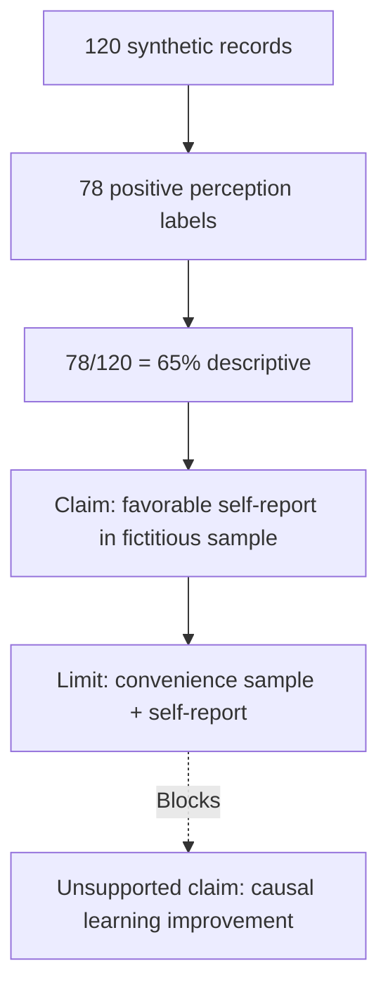

# Worked Simulation — Fully Synthetic / Simulasi Sepenuhnya Sintetis

> **SYNTHETIC TRAINING MATERIAL / MATERI LATIHAN SINTETIS.** Every dataset, count, statistic, institution, sample, and response below is fictional. Not evidence for an actual research paper.

## Case / Kasus

A fictional teaching team wants to study whether a feedback-support tool relates to students' **perceived** confidence and reflective learning. / Tim pengajar fiktif ingin meneliti hubungan alat bantu umpan balik dengan **persepsi** kepercayaan diri dan pembelajaran reflektif.

- **Hypothetical sample / sampel hipotetis:** n = 120 fictional observations, convenience sample, one semester.
- **Illustrative questionnaire / kuesioner contoh:** 5-point perception scale. Measurement reliability and construct validity are NOT established.
- **Illustrative descriptive result / angka contoh:** 78/120 students chose category 4–5; this is **65% of this synthetic sample**, not a population estimate.
- **Critical threat:** no baseline, no random assignment, no verified control group.

## Bad-to-good claim revision / Koreksi klaim

**INVALID / TIDAK SAH:** “AI feedback causes a 65% improvement in student learning outcomes.”

**DEFENSIBLE SYNTHETIC WORDING / NARASI SINTETIS YANG LEBIH SAH:** “In this hypothetical convenience sample, 65% selected favorable self-report categories. This is not evidence of learning improvement or causal impact.” / “Dalam sampel kemudahan hipotetis ini, 65% memilih kategori persepsi positif; temuan tersebut tidak membuktikan peningkatan hasil belajar atau dampak kausal.”

## Claim chain / Rantai argumentasi

## Multi-meta critique / Kritik multi-meta

| Lens / Lensa | Issue / Isu | Decision / Keputusan |
|---|---|---|
| Epistemic | Descriptive percentage does not measure objective skill | HOLD objective learning claims |
| Methodological | No control or baseline; convenience sample | HOLD causal claims |
| Logical | Self-report can reflect satisfaction, not mastery | Include rival explanation |
| Communicative | “65% improved” is misleading | Replace with precise denominator-based phrasing |
| Ethical/systemic | Data are fictional; no consent issue in simulation, but real deployment requires review | Explicitly mark synthetic, specify real-study ethics plan |

## Reviewer simulation / Simulasi penelaah

**Reviewer 1 (method):** “Why is association treated as causality?”  
**Author response (proposed, not executed):** “We will restrict the report to descriptive perceptions and revise causal verbs; a separate longitudinal or randomized design would be required to estimate an intervention effect.”

**Reviewer 2 (theory):** “What is the conceptual mechanism?”  
**Author response (proposed):** “We will define feedback quality, self-regulated learning and perceived confidence separately, then test whether appropriate prior literature supports a plausible conceptual link.”

**Editor (simulation):** `HOLD — insufficient real study evidence`. The imaginary manuscript is **not** submission ready.

## Teaching transfer / Transfer pembelajaran

Have learners identify four additional fallacies, redesign the study under fixed budget, create an honest abstract with no invented statistics beyond the marked fictional example, and complete `templates/claim-matrix.md`.

