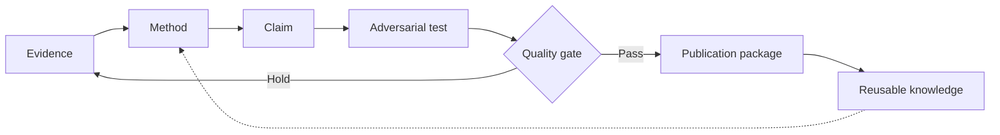

# Operational Research Playbook — English

**Research-to-Publication AI v2.0 | Tri Aji Nugroho**

## Execution philosophy

**Research is a bridge-building discipline.** The research question represents a crossing need; methodology is structural calculation; data are tested materials; writing is the visible surface; review is a load test. Polishing the surface cannot replace structural validity.

**Endgame-backward:** begin with trustworthy, useful knowledge; work backward through defensible inference, reviewer-ready artifacts, analysis, study design, and source evidence. **Pareto prioritization:** address validity threats before minor stylistic issues. **Inversion:** imagine the manuscript failing because of an avoidable defect; then test whether the defect has truly been mitigated.

## Eighteen-stage workflow

| Stage | Focus | Decision/artifact |
|---|---|---|
| S00 | **Purpose and scope** — Define impact, audience, target, novelty ambition, constraints and permissible data. | Study card + endgame decision |
| S01 | **Evidence inventory** — Inspect protocols, provenance, consent, methods, scripts, sample and source integrity. | Evidence ledger + hold/go |
| S02 | **Research question** — Define question, construct boundaries, population, comparator and falsifiable hypotheses where appropriate. | RQ + estimand |
| S03 | **Literature and research gap** — Search credible sources, document query, time window, inclusions/exclusions, rival findings. | Literature map + bounded gap |
| S04 | **Theory and claims** — Map mechanism, constructs, causal alternatives and conditions. | Claim-evidence graph |
| S05 | **Design, sampling and ethics** — Select design, anticipate power/precision where meaningful, check access and participant safeguards. | Protocol, sampling/ethics register |
| S06 | **Analysis plan** — Choose variables, cleaning rules, model assumptions, multiple-testing and missing-data handling before inspecting outcomes where possible. | Reproducible analysis plan |
| S07 | **Execute and verify** — Run authorized computations and validate output with independent checks; never invent numbers. | Verified statistical/qualitative artifacts |
| S08 | **Results** — Report descriptive and inferential findings exactly; distinguish observed results and interpretations. | Tables, figures and Results text |
| S09 | **Introduction** — Build problem, state of art, exact gap, significance and RQ without overclaim. | Introduction argument |
| S10 | **Discussion** — Compare rival explanations and literature, mechanisms, contribution, practical implications and boundaries. | Discussion logic |
| S11 | **Limitations and impact** — Distinguish statistical, external, construct, ethical and operational limitations; propose justified next work. | Limitations + implication matrix |
| S12 | **Title, abstract and keywords** — Compress accurate core claim into appropriate abstract format and searchable terms. | Title, abstract, keywords |
| S13 | **References and venue** — Cross-check each citation, DOI, authorship, ethics disclosures, scope, fee and live author guidelines. | Citation and compliance report |
| S14 | **Adversarial peer review** — Run independent methodological, theoretical and editorial critiques; never forecast guaranteed acceptance. | Reviewer matrix + action plan |
| S15 | **Submission pack** — Generate cover letter and declarations from verified metadata; request human approval before actual submission. | Conditional submission checklist |
| S16 | **Revision and rebuttal** — Respond point-by-point with tracked manuscript changes and evidence; acknowledge disagreements politely. | Reviewer response and revision log |
| S17 | **Knowledge compounding** — Archive decisions, reproducibility assets, lessons, dataset permissions and research questions for subsequent teams. | Reusable knowledge assets |

## Decision protocol for EVERY stage

1. **Facts:** identify the exact files, dates, sample, data type, and verification status.
2. **Five-lens meta-review:** epistemic, methodological, logical, communicative, ethical/systemic; operate at micro-claim, meso-manuscript and macro-program levels.
3. **MECE issue tree:** separate integrity, validity, contribution, presentation and venue; record causal cross-links without counting the same defect twice.
4. **Rival explanations:** develop at least two plausible competing hypotheses or interpretations.
5. **Simulation:** best, base and worst **assumption-driven** scenarios; never assert them as predictions or observed results.
6. **Quality gate:** GO, CONDITIONAL GO, or HOLD. Name a decision owner and unlocking evidence.
7. **Reusable assets:** update the evidence ledger and decision log.

## Speed is not a substitute for validity

| Horizon | Permissible deliverables | Non-negotiable boundary |
|---|---|---|
| Day 1 | file inventory, method audit, claim map, missing-input list | no invented observations, DOI, ethics approval or absolute novelty |
| Days 3–7 | executable analysis when data exist, IMRaD draft, verification, simulated review | no invented indexing or acceptance probabilities |
| Weeks 2–4 | sensitivity analyses, triangulation, revisions and author approvals | no publication guarantee |

## Conditional decision example

**Finding:** A survey dataset is available, but participant consent and data sharing permission have not been audited.  
**Decision:** HOLD external dataset transfer; GO for local instrument review and analysis planning.  
**Risk:** sampling bias, confounding, instrument validity and privacy.  
**Top three actions:** (1) audit consent and access; (2) reconcile variable codes and records; (3) prerecord a transparent analytical specification before Results writing.  
**Pass criterion:** documented permission, codebook and reproducible computations.

## Reusable quality loop

## Research design adaptations

- **Quantitative:** sample size, missingness, measurement reliability, model assumptions, estimate, CI and sensitivity. Association is not automatically causation.
- **Qualitative:** reflexivity, sampling, codebook, negative cases and audit trail. Never fabricate participant quotes.
- **Mixed methods:** explain integration, not just parallel methods.
- **Systematic review:** transparent protocol, searches, deduplication, eligibility, quality appraisal and PRISMA where appropriate.
- **Computing/AI:** baselines, data leakage, train/test integrity, configurations, reproducibility, robustness, fairness and artifacts.

