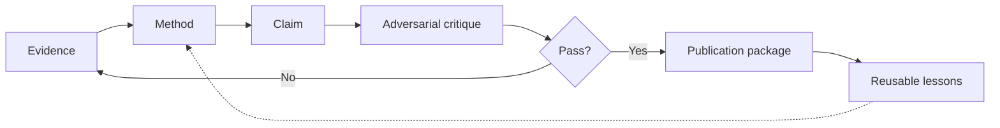

# Playbook Operasional — Bahasa Indonesia

**Research-to-Publication AI v2.0 | Tri Aji Nugroho**

## Filosofi pelaksanaan

**Penelitian ibarat membangun jembatan.** Pertanyaan riset adalah kebutuhan penyeberangan; metode adalah perhitungan struktur; data adalah material teruji; narasi adalah permukaan jalan; reviewer adalah uji beban. Memoles permukaan tanpa menguji struktur adalah risiko, bukan kemajuan.

**Prinsip endgame–backward:** mulai dari kemanfaatan pengetahuan yang dapat dipercaya; tarik mundur ke kriteria klaim yang sah, artefak untuk reviewer, analisis, desain, dan sumber data. **Prioritas Pareto:** tangani kesalahan yang paling merusak validitas terlebih dahulu, bukan kosmetik kalimat. **Inversion:** bayangkan paper ditolak karena cacat fatal, kemudian buktikan titik rawan telah dimitigasi.

## Alur kerja 18 tahap

| Tahap | Fokus | Keputusan/artefak |
|---|---|---|
| S00 | **Tujuan dan cakupan** — Tetapkan dampak, pembaca, venue, ambisi kontribusi, batasan dan izin data. | kartu studi + keputusan hasil akhir |
| S01 | **Inventaris bukti** — Audit protokol, asal data, izin, instrumen, skrip, sampel, dan integritas sumber. | buku besar bukti + tahan/lanjut |
| S02 | **Pertanyaan penelitian** — Rumuskan pertanyaan, konstruk, populasi, pembanding, hipotesis yang dapat diuji bila relevan. | pertanyaan + estimand |
| S03 | **Literatur dan celah riset** — Telusuri sumber kredibel, catat kueri, rentang waktu, inklusi/eksklusi dan temuan berlawanan. | peta pustaka + celah terukur |
| S04 | **Teori dan klaim** — Petakan mekanisme, konstruk, alternatif kausal dan kondisi pembatas. | graf klaim-bukti |
| S05 | **Desain, sampling, etika** — Pilih desain, cek presisi/daya bila relevan, izin akses dan perlindungan partisipan. | protokol, register sampel/etik |
| S06 | **Rencana analisis** — Tentukan variabel, pembersihan, asumsi, uji berganda dan missingness sebelum hasil bila mungkin. | rencana analisis reproduktif |
| S07 | **Hitung dan verifikasi** — Jalankan perhitungan sah, cocokkan melalui pemeriksaan independen; dilarang mengarang angka. | artefak analisis tervalidasi |
| S08 | **Hasil** — Sajikan temuan secara tepat; pisahkan hasil pengamatan dan interpretasi. | tabel, gambar dan bagian Hasil |
| S09 | **Pendahuluan** — Susun masalah, mutakhir ilmu, celah, signifikansi dan RQ tanpa klaim berlebihan. | argumen Pendahuluan |
| S10 | **Pembahasan** — Bandingkan penjelasan tandingan dan literatur, mekanisme, kontribusi, implikasi dan batasan. | logika Pembahasan |
| S11 | **Keterbatasan dan dampak** — Pisahkan keterbatasan statistik, generalisasi, konstruk, etika dan implementasi. | matriks batasan + implikasi |
| S12 | **Judul, abstrak, kata kunci** — Ringkas klaim sah ke abstrak sesuai format dan istilah pencarian. | judul, abstrak, kata kunci |
| S13 | **Referensi dan jurnal** — Verifikasi sitasi, DOI, kepengarangan, pengungkapan, cakupan, biaya dan panduan terkini. | audit sitasi dan kepatuhan |
| S14 | **Simulasi reviewer** — Jalankan kritik metodologi, teori dan editorial secara independen, bukan ramalan penerimaan. | matriks reviewer + tindakan |
| S15 | **Paket submit** — Susun cover letter dan deklarasi dari metadata terverifikasi; minta persetujuan manusia sebelum mengirim. | daftar kelengkapan bersyarat |
| S16 | **Revisi dan tanggapan** — Jawab per poin beserta perubahan terlacak dan bukti; tanggapi perbedaan pendapat secara santun. | surat tanggapan dan log revisi |
| S17 | **Penggandaan pengetahuan** — Arsipkan keputusan, aset replikasi, pembelajaran, izin data dan agenda riset lanjut. | aset pengetahuan berulang |

## Siklus keputusan pada SETIAP tahap

1. **Fakta:** sebutkan file, tanggal, nomor sampel, jenis data, dan status verifikasi.
2. **Meta-thinking lima lensa:** epistemik, metodologis, logis, komunikatif, etis/sistemik; bedakan mikro (klaim), meso (manuskrip), makro (agenda riset).
3. **Issue tree MECE:** pisahkan integritas, validitas, kontribusi, presentasi dan venue; hubungkan irisan tanpa menghitung dua kali.
4. **Alternatif:** bandingkan minimal dua hipotesis atau penjelasan tandingan yang masuk akal.
5. **Simulasi:** buat skenario terbaik, dasar dan terburuk **sebagai asumsi**, bukan proyeksi faktual.
6. **Quality gate:** GO, CONDITIONAL GO atau HOLD. Tandai PIC dan bukti yang diperlukan.
7. **Artefak:** simpan evidence ledger dan decision log agar dapat digunakan kembali.

## Rencana cepat vs mutu

| Horizon | Yang boleh dibuat | Yang tidak boleh dipalsukan |
|---|---|---|
| 1 hari | inventaris berkas, pengujian metode, kerangka argumen, daftar kekurangan | hasil, DOI, ethics approval, novelty absolut |
| 3–7 hari | analisis bila data ada, draft IMRaD, verifikasi sumber, reviewer simulation | persentase keberterimaan dan kepastian indeks |
| 2–4 minggu | analisis sensitifitas, triangulasi, revisi, persetujuan penulis | jaminan lolos review |

## Pola keluaran contoh — keputusan bersyarat

**Temuan:** Dataset survei tersedia, tetapi identitas partisipan dan prosedur consent belum diaudit.  
**Keputusan:** HOLD berbagi dataset eksternal; GO untuk audit instrumen dan rancangan analisis secara lokal.  
**Risiko:** bias sampel, confounding, instrumen yang belum tervalidasi, pelanggaran privasi.  
**Tiga tindakan:** (1) audit consent dan akses; (2) cocokkan kode variabel dan data; (3) susun analysis plan sebelum penulisan Results.  
**Tanda selesai:** bukti izin, codebook dan analisis yang dapat direproduksi tersedia.

## Diagram siklus perbaikan

## Ruang lingkup akademik lintas bidang

- **Kuantitatif:** ukuran sampel, missingness, reliabilitas, model, estimasi, confidence interval, sensitivitas; jangan otomatis mengklaim kausalitas.
- **Kualitatif:** reflexivity, sampling, codebook, negative cases, audit trail; jangan menciptakan kutipan partisipan.
- **Mixed methods:** jelaskan integrasi data/temuan, bukan hanya menaruh dua analisis berdampingan.
- **Systematic review:** protokol, strategi pencarian, deduplikasi, inklusi, quality appraisal, PRISMA bila sesuai.
- **Komputasi/AI:** baseline, kebocoran data, pemisahan train/test, konfigurasi, reproducibility, robustness, fairness dan artefak eksperimen.

