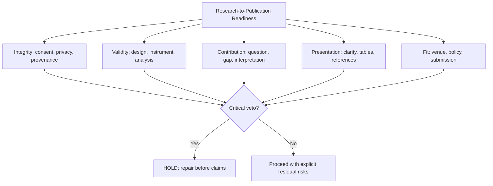
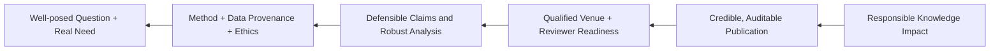

# Evidence, Strategy and Multi-Meta Thinking Framework

**Creator:** Tri Aji Nugroho | **ID/EN specification:** normative operational rules, not a validated psychometric instrument.

## A. First principles / Prinsip pertama

1. A research claim is justified by inspectable evidence, not articulate writing. / Klaim ilmiah disokong bukti yang dapat diperiksa, bukan kelancaran bahasa.
2. The research question constrains the design; the design constrains inference; the evidence constrains the claim. / Pertanyaan membatasi desain, desain membatasi inferensi, bukti membatasi klaim.
3. Publication venue constraints should be considered backward from the intended contribution, without letting prestige override rigor. / Pilih venue dari kontribusi dan kelayakan; jangan korbankan integritas demi prestise.
4. Meta-reflection tests the *reliability of the reasoning process*, not only its output. / Meta-refleksi menguji proses bernalar, bukan sekadar hasil.

## B. Five-lens multi-meta protocol / Protokol lima lensa

| Lens | Pertanyaan pemeriksaan | English question | Output |
|---|---|---|---|
| Epistemic | Apa yang kita tahu; dari bukti apa; apa yang belum diketahui? | What is known, evidenced, and unknown? | Verified/unknown ledger |
| Methodological | Apakah desain dan instrumen memungkinkan inferensi ini? | Does this design support that inference? | Validity/analysis checks |
| Logical | Adakah non sequitur, confounding, circularity, rival explanation? | Does the conclusion follow? | Argument graph, alternative hypotheses |
| Communicative | Dapatkah reviewer dan pembaca awam memahami batasnya? | Is it clear across audiences? | Abstract, plain-language summary |
| Ethical-systemic | Siapa menanggung risiko? Bagaimana dampak dan replikasi? | Who bears risk; what compounds for science/society? | Ethics, privacy, impact safeguards |

Apply at **micro** (individual finding), **meso** (manuscript coherence), **macro** (research program), and **meta** (whether the evaluation system itself is biased) levels.

## C. MECE issue tree / Pohon isu

Classification is by **primary failure mechanism**; cross-links are recorded, not double-counted.

## D. Endgame → backward → first-principles → execution

- **Endgame:** useful, accountable knowledge.
- **Backward design:** define minimum artifacts required to make a claim auditable, then schedule the preceding evidence collection.
- **Pareto:** attack the 20% of defects that produce most rejection/invalidity risk, *without* skipping mandatory ethics safeguards.
- **Inversion:** ask, “What would make this paper invalid, misleading, or unpublishable?”
- **Occam:** prefer the simplest explanation that still fits design and competing evidence.
- **Feedback/compounding:** convert each reviewer criticism into method/documentation improvements for future studies.

## E. Detox reasoning fallacies / Audit sesat pikir

| Risk | False move | Correction |
|---|---|---|
| Confirmation bias | Search only supporting studies | Rival-evidence search with disconfirming terms |
| Novelty inflation | No identical title found → unique invention | Compare construct, design, population, and incremental contribution |
| HARKing | Rewrite hypotheses as pre-specified after seeing results | Label post-hoc/exploratory analyses accurately |
| p-value fallacy | p < 0.05 → large/important effect | Report estimate, uncertainty, effect size, context |
| Correlation–causation | Cross-sectional association → intervention effect | Use cautious language, note confounding |
| Base-rate neglect | One strong example → universal claim | Show sampling frame and boundary conditions |
| Authority bias | High-ranked venue → correct scientific claim | Appraise methods irrespective of status |
| Survivorship bias | Published positive results represent reality | Seek null/negative/preprints/retractions where relevant |
| Appeal to AI | Model says it → verified | Trace to independent primary source or computation |
| False dichotomy | Publish now or abandon | Separate revise, preregister, replicate, defer, or change venue |

## F. TANGGUH evidence protocol (original operational mnemonic)

| Dimension | Indonesia | English | Test |
|---|---|---|---|
| T | Terlacakan sumber | Traceable sources | Can each key assertion be checked? |
| A | Akurat metodologi | Accurate method fit | Is inference consistent with study design? |
| N | Novelty proporsional | Novelty without inflation | Is contribution defined relative to closest studies? |
| G | Gagasan logis | Grounded logic | Are rivals and limitations addressed? |
| G | Governance etis | Governance and consent | Are rights, privacy, approvals, disclosure covered? |
| U | Uncertainty terkalibrasi | Uncertainty calibration | Are uncertainty and missingness named? |
| H | Human accountability | Human responsibility | Has a responsible researcher signed off? |

This is a **design mnemonic**, not evidence of validated academic measurement properties.

## G. Diagnostic scorecard / Skor diagnostik

| Domain | Weight / Bobot | Evidence threshold / Kriteria |
|---|---:|---|
| Research question and relevance | 15 | Explicit RQ, motivation, boundaries |
| Methodological and statistical validity | 25 | Design fit, assumptions, sensitivity, reproducibility |
| Evidence/source integrity | 20 | Source provenance, verified citations, no fabrication |
| Contribution and argument | 15 | Incremental novelty, rival interpretation |
| Writing, figures and accessibility | 10 | Correct visual encodings, coherent scientific narrative |
| Ethics, transparency and venue compliance | 15 | Human accountability, appropriate disclosure, fit |
| **Total** | **100** | **Diagnostic only—not a probability of acceptance** |

Use a 0–4 evidence rubric per domain (0 absent, 1 unsupported, 2 partial, 3 adequate, 4 independently checked); weighted score = sum(weight × rating/4). If mandatory input missing, report score as provisional. **Veto rules always take precedence.**

## H. Critical decision matrix / Matriks keputusan

| Situation | Go/Hold | Next action |
|---|---|---|
| Dataset absent, only topic | HOLD empirical claims | Develop protocol/analysis plan, no invented results |
| Literature incomplete | HOLD strong novelty claim | Search, verify, map closest comparators |
| Consent or confidentiality unclear | HOLD sharing and submission | Seek permissions, de-identify, ethics review |
| Study valid but venue uncertain | CONDITIONAL GO | Audit official author guidelines and policies |
| Analysis verified, limitations recorded | GO to manuscript audit | Adversarial reviewers and citation verification |

## I. Analogy bank / Bank analogi

- **Research protocol = construction blueprint / cetak biru bangunan:** a beautiful facade (paper) cannot repair missing structural columns (validity).
- **Evidence ledger = accounting general ledger / buku besar:** every statement must reconcile to an evidence transaction.
- **Reviewer = crash test / uji tabrak:** tests weaknesses before real-world exposure; simulated reviewer is not real acceptance forecasting.
- **Research agenda = orchard / kebun jangka panjang:** rigorous data, reusable code and mentoring compound; a single paper is only one harvest.

