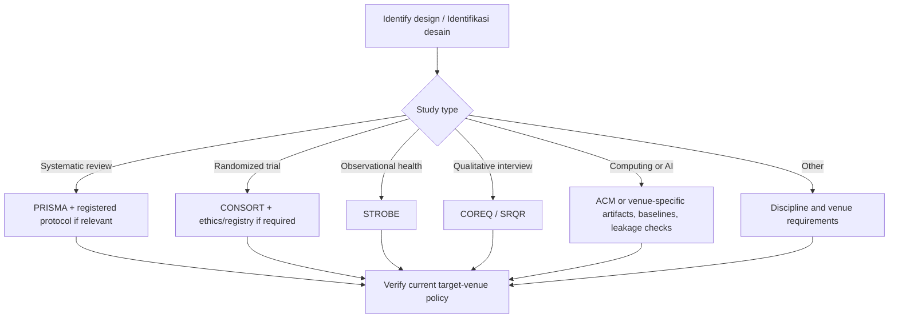

# Resource & Reference Library / Pustaka Referensi Lokal–Nasional–Global

**Verified/ditinjau untuk edisi 2026-10-14:** primary portals listed below; individual institutional or journal versions require checking at point of use. These are **external references**, not material relicensed into this proprietary skill. Verify current institutional policies, versions, access conditions and applicability before submission.

## 1. Institutional / Lokal

| Resource / Sumber | Use / Pemakaian | Evidence requirement |
|---|---|---|
| University research and ethics office / LPPM, research integrity office | Funding contracts, required reports, conflict of interest, participant protection | Request the current official guide; log issuance date, approver, URL/file path |
| Department / program study method guidelines | Discipline conventions and assessment rubrics | Check currently approved curriculum/research handbook |
| Institutional repository and library subscription | Past theses, local methods and accessible primary texts | Resolve full citations and permissions; do not assume subscriptions grant redistribution rights |
| Target symposium/conference/journal (e.g., an actual institutional proceeding) | Author guideline, template, deadline, peer-review policy | Fetch CURRENT official call; log date/version; never infer from prior year |

**UAI implementation overlay / lapis konteks UAI (conditional):** Use authorized and current policies from UAI/LPPM, SRG reporting documents and event/conference calls *only when supplied or retrievable*. No claim is made that this skill constitutes official UAI policy.

## 2. National / Indonesia

| Authority/resource | Main use | Official URL | Scope caution |
|---|---|---|---|
| SINTA — Science and Technology Index | Indonesian journal/researcher/institution discovery and indicators | https://sinta.kemdikbud.go.id/ | Index and status are time-sensitive; not a proxy for methodological quality |
| GARUDA — Garba Rujukan Digital | Indonesian literature discovery | https://garuda.kemdikbud.go.id/ | Verify full texts and bibliographic metadata with publisher |
| Indonesia OneSearch / Perpusnas | Library and Indonesian holdings discovery | https://onesearch.id/ | Holdings are not peer-review certification |
| DJKI — Direktorat Jenderal Kekayaan Intelektual | General copyright and recordal information | https://www.dgip.go.id/ | Recordal/registration, authorship and protectability require legal review |
| BRIN | Research policy, ecosystem and publicly issued guidance | https://www.brin.go.id/ | Select applicable, dated formal documents rather than relying on general portal |
| JDIH national legislation / JDIHN | Locate laws and implementing regulations | https://jdihn.go.id/ | Confirm authoritative legal text and latest amendments |
| RISTEK/BIMA program portal | Grant reporting, eligible outputs and deadlines where relevant | https://bima.kemdikbud.go.id/ | Program-specific rules change; verify access and current year |

## 3. Global / Internasional

| Reference | Use | Official URL | Applies when |
|---|---|---|---|
| COPE Core Practices | Publication ethics, integrity, editorial procedures | https://publicationethics.org/core-practices | Editorial and scholarly integrity (context-dependent) |
| ICMJE Recommendations | Authorship, AI disclosures, overlapping publication and medical-journal practice | https://www.icmje.org/recommendations/ | Medical/biomedical venue, or as reference with scope caveat |
| EQUATOR reporting guideline finder | Locate study-design-specific health research reporting standards | https://www.equator-network.org/ | Particularly health-related studies |
| PRISMA 2020 | Reporting systematic reviews | https://www.prisma-statement.org/prisma-2020 | Systematic reviews—not every narrative review |
| CONSORT | Randomized trial reporting | https://www.consort-statement.org/ | Randomized trials; check current extension/version |
| STROBE | Observational epidemiological reporting | https://www.strobe-statement.org/ | Relevant observational health studies |
| SRQR | Reporting qualitative research | https://www.equator-network.org/reporting-guidelines/srqr/ | Appropriate qualitative studies; check field fit |
| COREQ | Qualitative interviews and focus groups | https://www.equator-network.org/reporting-guidelines/coreq/ | Interviews / focus groups in suitable domains |
| CRediT (NISO) | Describing human contributor roles | https://credit.niso.org/ | Contributorship where requested; not automatic authorship eligibility |
| Crossref | DOI and publication metadata verification | https://www.crossref.org/services/metadata-retrieval/ | Bibliographic verification; DOI presence ≠ methodological quality |
| ORCID | Persistent contributor identifier | https://orcid.org/ | Researcher attribution/profile |
| DOAJ | OA journal discovery | https://doaj.org/ | Journal discovery, not guaranteed acceptance |
| Think. Check. Submit. | Assess publisher/journal trustworthiness | https://thinkchecksubmit.org/ | Venue due diligence |
| DORA | Responsible research assessment | https://sfdora.org/ | Avoid venue metric substitution for paper quality |
| FAIR Principles / GO FAIR | Research data discoverability, accessibility, interoperability and reuse | https://www.go-fair.org/fair-principles/ | Data stewardship subject to legal/privacy restrictions |
| ACM Artifact Review and Badging | Computational reproducibility and artifact transparency | https://www.acm.org/publications/policies/artifact-review-and-badging-current | Computing venue where applicable |

## 4. Fit routing / Pemilihan rujukan berdasarkan desain

## 5. Resource selection test / Uji pemilihan sumber

For each reference log: `R-ID | authority | title / URL | date accessed | version | applicability | licensing | primary/secondary | verified?`.

A portal homepage proves existence of a resource, **not** that a specific law, indexing tier, deadline, or requirement is current. Prefer primary official sources. If source access fails, disclose and mark `UNVERIFIED`.

**External-source use boundary:** hyperlinked guidance and reporting checklists remain third-party works. Refer to them, do not bulk-copy their copyrighted text or imply endorsement of this skill.

